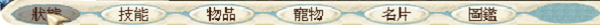

# BlueCG 圖形、縮放與功率實測報告（階段版）

> **根因補測已完成：** 後續 7 組原生 2× 截圖、16 組 registry 初始化及字體正控制已定位此版 `bluecg.dll` 自行指定 COLORONCOLOR 的最終拉伸。詳見 [registry／DDRAW／字體根因報告](scaling-root-cause-2026-11-01.zh-TW.md)。此補測不作為能耗或遊戲幀時間比較。

> **畫質結論修正（2026-11-01 追加測試）**：使用者後續回憶，先前 GL 可能本來也有階梯感；目前沒有足夠證據判定這是本輪新增的 GL 退化。前述相同像素結果取自 Peekaboo 預設 **1× 邏輯解析度**輸出，不能直接代表原生 Retina 像素相同。新增 `--retina` 截圖與其他設定對照詳見文末；三開及能耗參數矩陣仍未完成。

更新：2026-11-01，Asia/Taipei。此版涵蓋已完成並核對的 **12 組單開測量**；尚未完成三開與其餘參數矩陣，不能當成全部驗證結案。

## 簡短結論

- 固定高速／無透明模式 HD[1] 與同一室內場景，單開三輪 GL→GDI→GL 均支持：GDI 降低遊戲 CPU 約 **41–43%**，CPU＋GPU＋ANE 合計估計功率約 **24–27%**。
- 兩路徑均約每秒提交 60 次畫面，P95 提交間隔接近；目前證據支持資源用量下降，**尚未證明卡頓或實際顯示幀時間改善**。
- 原尺寸與放大後的指定靜態字體區域，GL／GDI 像素差為零；未重現「只有 GDI 破字」。放大時實際寬高比例不同，兩者都有共同的縮放限制；尚未證明所有字串與動畫都沒有問題。
- WineD3D no3d 不等於全面停用透明。受控 GDI AlphaBlend 測試仍有正確混色；遊戲 HD[1] 的「無透明」屬於另一個設定。

## 測試範圍與環境

| 項目 | 本次條件 |
|---|---|
| 主機 | Apple M4、10 核 CPU、16 GiB RAM |
| 系統 | macOS 27.2（26B123） |
| 顯示器 | 1680×945 points、backing scale 2、最高 60 Hz |
| 電源 | AC；macOS 低耗電模式關閉；正式採樣前已中斷遠端畫面共享 |
| 遊戲 | BlueLauncher 2026.10.27.01；BlueCG core 2026/11/01 05:55:36 |
| 引擎 | fullscreen-fix 測試基線，另加本機 GDI／DDraw 計時探針；非正式發佈版本 |
| 場景 | 同一測試角色、室內靜態場景、狀態面板；不代表戰鬥或擁擠地圖 |
| 遊戲模式 | HD[1] 高速／無透明；3Ddevice:1、GAHD；未啟用 --soft3d |
| Retina／DPI | 主矩陣 Retina 關閉、預設 DPI；尚未做 Retina／DPI 交叉矩陣 |
| 程序 | 一個遊戲、一個 launcher、一個該測試 prefix 專屬 wineserver；逐次重啟 |
| 隔離 | 獨立遊戲副本／prefix；未新增 BlueCG CompatDB 規則，未更改其他遊戲設定 |

遊戲核心 SHA-256：`832fd1de73783849251a1b397f082d289feb957eaabac1473a77ce4a28d8ed1a`。

實際載入與子程序設定已透過模組、診斷及程序身分檢查核對，並非只憑環境變數推定 renderer。遊戲目錄有官方 DDRAW 檔案，不代表正式組已載入該檔；本次基線確認為 Wine builtin 路徑。

## 指標定義與限制

- CPU：累積程序 CPU time 差值／實際經過時間；**100% 等於一個核心**。總 CPU 僅加總表列遊戲、launcher、專屬 wineserver。
- Combined：powermetrics 的 **CPU＋GPU＋ANE 合計估計功率**，包含全系統其他程序的負載；**不是 Wine 程序功率加總，也不是整機插座功率**。GPU 使用與 Combined 同一 processor section 欄位，沒有重複加總另一 GPU sampler 欄位。
- 程序 Energy Impact 是指數，不能換算成 W 或 J；本表不用它冒充逐程序功率。
- 計時：實際遊戲視窗的成功 GDI BitBlt 全畫面提交，核對 HWND、完整矩形、SRCCOPY 與唯一輸出執行緒。**不是 GPU 完成、螢幕掃描輸出或遊戲動畫更新率**。API 呼叫成功也不保證螢幕已顯示。
- 每組暖機 60 秒、正式 CPU 採樣 300 秒（60×5 秒）。功率保留完整原始輸出，按可對齊的完整區間加權；時間戳只有整秒，邊界保守排除，實際涵蓋時間另列。
- 正式組焦點不符樣本均為 0，thermal state 最高均為 0，低耗電模式均關閉；這些是系統觀測，非晶片溫度量測。
- powermetrics 原始輸出反覆出現 `Second underflow occured.`。原因與影響尚未定位；功率值仍有此未解限制，不能視為已校準的絕對耗電。
- 所有正式組使用相同計時探針。短控制測試已核對事件數、錯誤狀態與透明混色；尚不能證明探針零開銷，亦未以正式場景完成獨立長時間開關對照。

## 單開原尺寸：三輪 A/B/A

尺寸為 Win32 client 961×721；原生視窗含標題列為 961×753 points。以下為各 run 平均值；幀欄位均指提交間隔。

| Run | 遊戲 CPU % | wineserver CPU % | launcher CPU % | 指定程序總 CPU % | CPU W | GPU W | Combined W | P95 ms | P99 ms | >50 ms 次數 |
|---|---:|---:|---:|---:|---:|---:|---:|---:|---:|---:|
| gl-r1 | 78.00 | 0.390 | 0.007 | 78.40 | 5.325 | 0.135 | 5.460 | 22.834 | 24.353 | 0 |
| gdi-r1 | 45.11 | 0.387 | 0.103 | 45.60 | 3.889 | 0.130 | 4.020 | 22.798 | 24.573 | 0 |
| gl-r2 | 79.26 | 0.430 | 0.140 | 79.83 | 5.404 | 0.141 | 5.546 | 23.067 | 25.201 | 2 |
| gl-r3 | 76.20 | 0.407 | 0.110 | 76.72 | 5.149 | 0.125 | 5.274 | 23.224 | 25.154 | 3 |
| gdi-r2 | 45.37 | 0.400 | 0.123 | 45.89 | 3.902 | 0.117 | 4.019 | 23.064 | 24.769 | 0 |
| gl-r4 | 76.90 | 0.410 | 0.127 | 77.43 | 5.117 | 0.118 | 5.235 | 23.079 | 25.025 | 0 |
| gl-r5 | 76.73 | 0.417 | 0.130 | 77.28 | 5.149 | 0.118 | 5.267 | 22.718 | 24.169 | 0 |
| gdi-r3 | 45.31 | 0.400 | 0.127 | 45.84 | 3.884 | 0.117 | 4.001 | 22.776 | 24.407 | 0 |
| gl-r6 | 76.78 | 0.423 | 0.130 | 77.33 | 5.313 | 0.118 | 5.431 | 23.140 | 25.342 | 1 |

各輪以兩側 GL 的算術平均作該輪對照，再計算 GDI 降幅；不同輪不當成同時測量，也未提供統計顯著性結論。

| 輪次 | GL 對照 CPU % | GDI CPU % | 遊戲 CPU 降幅 | GL 對照 Combined W | GDI Combined W | Combined 降幅 | GL 前後 CPU 漂移 |
|---|---:|---:|---:|---:|---:|---:|---:|
| 1 | 78.63 | 45.11 | 42.63% | 5.503 | 4.020 | 26.95% | +1.61% |
| 2 | 76.55 | 45.37 | 40.73% | 5.254 | 4.019 | 23.52% | +0.91% |
| 3 | 76.75 | 45.31 | 40.97% | 5.349 | 4.001 | 25.20% | +0.07% |

描述性平均：GL 遊戲 CPU 77.31%、GDI 45.26%；Combined 分別 5.369 W、4.013 W。P95 的 run 平均分別 23.010／22.879 ms，差距很小；這不是合併所有事件後的 P95。

## 放大視窗：一輪 A/B/A

要求 client 1441×1081，但實際受桌面可用高度限制，只有 **1441×791**，原生視窗 1441×823 points。因此不是寬高都放大 1.5 倍，不能標成等比例 1.5× 測試。

| Run | 遊戲 CPU % | wineserver CPU % | launcher CPU % | 指定程序總 CPU % | Combined W | 提交次數／秒 | P95 ms | P99 ms | >50 ms 次數 |
|---|---:|---:|---:|---:|---:|---:|---:|---:|---:|
| gl-r1 | 92.92 | 0.413 | 0.010 | 93.34 | 6.193 | 60.001 | 24.725 | 26.922 | 0 |
| gdi-r1 | 59.21 | 0.437 | 0.090 | 59.74 | 4.922 | 59.999 | 24.818 | 27.723 | 0 |
| gl-r2 | 93.41 | 0.457 | 0.097 | 93.96 | 6.181 | 59.985 | 24.721 | 26.990 | 1 |

相對兩側 GL 平均，GDI 遊戲 CPU 降低 36.45%，Combined 降低 20.45%。兩路徑放大後都增加 CPU 用量；不能把增加部分全部歸因於字型或 GPU 讀回。放大組只有一輪，證據弱於原尺寸三輪。

## 字體、縮放與透明

| 問題 | 已有證據 | 判讀邊界 |
|---|---|---|
| 原尺寸 GL／GDI 字體差異 | 指定靜態字體 ROI 平均 RGB 絕對差 0 | 只涵蓋相同字串／面板，非全遊戲字型驗證 |
| 放大後 GL／GDI 字體差異 | 指定靜態字體 ROI 平均 RGB 絕對差 0 | 未重現 GDI 獨有破字；共同縮放失真仍可能存在 |
| 非等比例放大 | 實際 client 961×721 → 1441×791 | 寬高倍率不同，需區分幾何拉伸與字型光柵化問題 |
| 實際繪圖路徑 | 全畫面 BitBlt；放大 GDI run 的測後 sample 包含 NtGdiStretchBlt／stretch_bitmapinfo | 支持有 bitmap stretch；不能僅憑 BitBlt 的 stretch-mode 欄位認定最終濾鏡或完整根因 |
| no3d 與透明 | 36 次受控 GDI 測試中 AlphaBlend 均輸出正確半透明混色；no3d 診斷已確認 | no3d 不會全面禁止 2D alpha；不代表所有遊戲透明特效都正常 |
| HD[1] 無透明是否省資源 | 此版所有正式組均固定 HD[1] | 缺少同 renderer 下有／無透明的匹配對照，尚不能量化這個開關本身的節省 |

## 容易混淆的參數

| 設定 | 實際意義 | 此版進度 |
|---|---|---|
| WineD3D renderer=gl | WineD3D GL 路徑 | 已完成主矩陣 |
| WineD3D renderer=gdi／no3d | WineD3D 無 3D 路徑 | 已完成主矩陣；不等於遊戲無透明 |
| launcher HD[1] | 高速／無透明，實際帶 3Ddevice:1、GAHD | 主矩陣固定 |
| launcher HD[2] | 3Ddevice:2 軟體 3D 模式 | 尚未完成匹配功率對照 |
| launcher HD[5] | GACGSlow 資源模式 | 尚未完成匹配功率對照 |
| 腳本 --soft3d | 同時改為 3Ddevice:0 並移除 GAHD | 複合改動，尚未完成拆分對照 |
| macOS 低耗電模式 | 系統電源政策 | 主矩陣關閉，獨立比較未完成 |
| Cyder 省電模式 | 啟動程序的 taskpolicy 政策 | 獨立比較未完成；不可與系統低耗電模式混稱 |

模式名稱參考 [BlueCG 官方啟動器說明](https://www.bluecg.net/new/BlueCG_Launcher.html)，實際測試仍須核對子程序參數與載入模組。

## 各組採樣品質

CPU 均取完整 300 秒。下表功率採有效區間加權；警告欄是出現前述 underflow 訊息的 sample 數。原始完整輸出保留於本機私有證據，不公開帳號、角色畫面、完整 argv 或環境。

| Run | 功率涵蓋秒數 | 完整功率 samples | 警告 samples | 提交次數／秒 | 提交間隔中位數 ms |
|---|---:|---:|---:|---:|---:|
| single-hd1-gl-r1 | 297.083 | 59 | 57 | 60.001 | 18.7538 |
| enlarged-hd1-gl-r1 | 292.017 | 58 | 58 | 60.001 | 18.2365 |
| single-hd1-gdi-r1 | 292.020 | 58 | 58 | 60.001 | 18.6603 |
| enlarged-hd1-gdi-r1 | 292.050 | 58 | 57 | 59.999 | 17.6158 |
| single-hd1-gl-r2 | 291.911 | 58 | 58 | 59.993 | 18.5180 |
| enlarged-hd1-gl-r2 | 291.931 | 58 | 56 | 59.985 | 17.5224 |
| single-hd1-gl-r3 | 291.869 | 58 | 58 | 59.942 | 18.4049 |
| single-hd1-gdi-r2 | 291.926 | 58 | 57 | 59.999 | 18.3074 |
| single-hd1-gl-r4 | 296.878 | 59 | 59 | 60.002 | 18.4274 |
| single-hd1-gl-r5 | 291.857 | 58 | 58 | 60.000 | 18.4352 |
| single-hd1-gdi-r3 | 291.949 | 58 | 58 | 60.001 | 18.5065 |
| single-hd1-gl-r6 | 291.874 | 58 | 58 | 59.980 | 18.4506 |

## 尚未完成與不能下的結論

- 三開同場景、逐程序 CPU／wineserver、功率及每個視窗的提交間隔：尚未完成；不能把單開數值直接乘三。
- 有／無透明、HD[2]／HD[5]、3Ddevice:0 與 GAHD 的拆分組合，以及兩種省電政策：尚未完成。
- Retina／DPI、等比例 1.5×／2×、更多字串與透明動畫：尚未完成。
- 全螢幕裁切與正常退出的完整回歸：本版單開每組正常關閉，放大組正常還原，但這不等於所有全螢幕問題已修復。
- 實際顯示幀時間與戰鬥流暢性：目前只量到應用程式提交間隔，不能宣稱已解決卡頓。
- 不推薦立即建立預設 CompatDB 規則；保留目前預設與停用 override 的回復方式。

## 重測與還原

依 [實測程序與還原方式](benchmark-protocol.zh-TW.md) 在獨立 prefix 重做。同一輪固定場景、核心 hash、HD[1] 與大小，只切換 renderer；每組完整關閉後重新啟動。功率輸出保留全部 sampler 內容；CPU 與提交間隔使用相同定義。

這 12 組單開測試結束時，測試遊戲已正常關閉。測試副本與私有證據保留；功率採樣於 2026-11-01 約 20:27（Asia/Taipei）依六小時上限自動停止，已核對 sampler 不再存在且防休眠 supervisor 已結束；沒有修改持續性管理員政策。後續參數矩陣尚未完成，追加畫質測試不列入這 12 組正式能耗結果。

## 資料與工具

- [逐組去識別化數據 CSV](benchmark-results-2026-11-01.csv)：完整精度 CPU、CPU／GPU／Combined 功率、提交間隔統計與品質欄位。
- [CPU 採樣與一般幀間隔分析](../../../scripts/bluecg-benchmark.py)
- [完整 powermetrics 輸出解析](../../../scripts/bluecg-power-summary.py)
- [GDI 視窗提交事件解析](../../../scripts/bluecg-present-frames.py)
- 追蹤：[CyderBits Issue #15](https://github.com/dspp779/CyderBits/issues/15)。此報告尚未代表 issue 已結案或已上傳 GitHub。

## 補測：Alt+Enter 後底部選單（2026-11-01）

依使用者指定，分別從官方 launcher 以 GL、GDI/no3d 重新登入同一角色與召喚之間，使用相同 HD[1]、3Ddevice:1、GAHD、Retina 關閉及相同測試引擎。GL 正常退出後才啟動 GDI，沒有同時執行。不是用手動 resize 代替 Alt+Enter。

macOS Option+Enter 原生事件未觸發放大，改由已驗證遊戲 executable 與前景視窗的 Wine SendInput 發送 Alt 按下、Enter 按下／放開、Alt 放開。兩組實際 Win32 client 都是 **961×721 → 1100×791**；擷取 PNG 皆為 **1100×823**（含 32 pixels 標題列）。style 仍為 0x14cf0000，這是遊戲快捷鍵放大，不宣稱 exclusive fullscreen。

底部整條 ROI `(0,798)-(1100,823)` 共 27,500 pixels，GL／GDI 的 RGB 差異像素 **0**、平均絕對差 **0**；左側選單與右側「系統」分區也均為 0。下列裁圖只裁切、不另行重取樣，保留擷取檔像素；但 Peekaboo 擷取本身使用預設 1× 邏輯解析度，並非原生 Retina 像素。

GL：

GDI：

**這不是「字體完全平滑」的結論。** 放大後文字可見位圖拉伸的筆畫不均與階梯感，但這輪 GL 與 GDI 相同，沒有重現「只有 GDI 明顯變差」。先前的狀態面板 ROI 不能替代本次底部選單測試；本次補上了不同 ROI 與真正快捷鍵切換的直接證據。仍須與使用者先前的引擎、Retina／DPI、遊戲模式及放大尺寸做匹配，不能據此否定舊環境曾發生退化，也不能單憑截圖判定最終縮放濾鏡。

[去識別化尺寸與像素比較紀錄](assets/altenter-2026-11-01-comparison.json)。完整視窗原圖含測試角色名稱與畫面，保留本機私有證據，於對話交付使用者，未加入公開素材。

## 追加：追查先前 GL 平滑放大設定

使用者指出先前只有 GDI 階梯感明顯，要求重現 GL 平滑設定；後續補充記憶指向 10 月底本輪測試開始前，最後修正為「好像之前就都是階梯感了」。因此不再以「GL 是本輪才新增退化」作既定事實。**本次沒有建立可重現的舊 GL 平滑基線，也沒有證明 GDI 獨有畫質退化。**

### 捕捉解析度的修正

本機 Peekaboo 4.9.7 的 `see --help` 明載 `--retina` 才使用 native Retina resolution，預設為 1× logical。本報告前段的 1100×823 PNG 及 RGB 差 0 比較，是**邏輯解析度擷取檔**的結果。裁切程式未重取樣，不表示擷取工具本身沒有降採樣；不能將這些結果擴大為原生螢幕像素完全相同。

新增原生擷取確認：RetinaMode=y／192 DPI 組的 Win32 client 1922×1442 → 2200×1582，原生 PNG **2200×1646**；Cyder012 install runtime、Retina 關閉組的 client 961×721 → 1052×761，原生 PNG **2104×1586**。兩張圖的設定與最終大小不同，不能直接當成 renderer A/B 或計算跨組像素差來排名。

### 實際追加對照

以下只做畫質／功能觀測，沒有新增合格的 300 秒能耗 run。除另述外，遊戲核心固定 SHA-256 `832fd1de73783849251a1b397f082d289feb957eaabac1473a77ce4a28d8ed1a`，同角色、召喚之間、Retina 關閉及相同測試引擎。

| 組合 | 操作與直接觀測 | 限制／結論 |
|---|---|---|
| HD[1]／GL／builtin DDRAW | 原對照 961×721 → 1100×791 | 邏輯截圖底部有階梯感；與 GDI 邏輯截圖相同 |
| HD[5]／GL／builtin DDRAW | 官方模式確認帶 3Ddevice:1、GAHD、GACGS；Alt+Enter 至 1100×791 | 底部技能至圖鑑 ROI 與 HD[1] 邏輯 PNG RGB 差 0；未恢復可辨識的平滑 |
| 經典[1]／GL | 啟動為 640×480；Alt+Enter 變為 style 0x94000000、Win32 client 640×480、Cocoa 1680×945，擷取大多黑色；切回後將視窗改為 1100×791可顯示 | 經典 Alt+Enter 與 HD 視窗放大不是同一序列；本次有失敗擷取，不算平滑或全螢幕通過 |
| HD[2]／GL／builtin DDRAW | 實際帶 3Ddevice:2；Alt+Enter 至 1100×791 | 同一底部 ROI 與 HD[1] 邏輯 PNG RGB 差 0 |
| HD[1]／GL／native,builtin DDRAW | 載入診斷確認遊戲附帶 DDRAW 為 native，再委派 Wine builtin；Alt+Enter 得 1052×761，另對齊 1100×791 | 對齊尺寸後，底部 ROI 與 HD[1] builtin 邏輯 PNG RGB 差 0；DLL 順序本身沒有恢復平滑 |
| HD[3]／GL／builtin DDRAW | 實際帶 3Ddevice:3；Alt+Enter 至 1100×791 | 底部 ROI 與 HD[1] 邏輯 PNG RGB 差 0；不能只憑模式名稱宣稱 GPU 呈現 |
| HD[1]／GL／內建字型 | INI 改用 bundled／mingliu_ttf；實際測原生邊框拖曳及 Alt+Enter，後者至 1100×791 | 人物資料文字有字型差異，但底部 ROI 與 system 字型邏輯 PNG RGB 差 0；本次未靠換字型恢復底部平滑 |
| HD[1]／GL／Retina＋192 DPI | 舊文件候選組合；Win32 client 與原生 PNG 如上，已用 --retina 擷取 | 原生底部仍可見筆畫階梯；未完成同設定 GDI 原生像素配對，不能宣稱兩者在此組相同 |
| Cyder012 install runtime／最新核心／HD[1]／GL／native,builtin | 同場景 Alt+Enter 961×721 → 1052×761；原生 2× PNG 保存 | 原生底部仍可見階梯；版本與模組 hash 已記錄。這是本機 install 來源 runtime，未以發布封裝重新驗證，不把版本標籤當成全部程式碼相同 |
| Cyder012 install runtime／本輪開始時保存的舊核心 | 舊核心 hash `2a077cba7325953f1518fe83b7bdd0371a21e5b7d1f1e476a5eff87e3af0b937`；launcher 完整性檢查提示核心大小不符，已取消修復／啟動 | **未進入遊戲，沒有畫質結論**；使用者後續修正舊畫質記憶，停止此假設並完整還原 |

此表的底部 ROI 比較是 `(90,798)-(600,823)`，避開狀態按鈕 hover 差異；與前節整條底部比較範圍不同。相同像素只代表這個靜態區域在指定擷取尺度下相同，不代表全部畫面、動畫或原生像素相同。

### 呈現路徑與不能外推的部分

正式測試的 WineD3D GL／no3d 初始化已核對，但初始化 GL 不代表所有遊戲畫面都必然由 GL 完成。追加診斷可見部分模式登入階段持續出現 DirectDraw primary 事件，地圖／放大後則出現對遊戲 HWND 的 GDI StretchBlt，來源如 961×721、目的 1100×791、stretch mode 3（COLORONCOLOR）。這是實際 bitmap stretch 的證據，不能僅憑這條紀錄排除同程序仍有其他 GL 工作，也不把 GDI 提交時間當成完整顯示時間。

原 Cyder shared bottle 的只讀設定檢查發現 `ddraw=native,builtin`、RetinaMode=n、LogPixels=96；本次未修改該 shared bottle。先前隔離矩陣的 builtin-DDraw 條件與它不同，故正式 CPU／功率結果只能解釋為報告所列隔離條件，不直接等同使用者原本啟動環境。

### 原生像素裁圖

下列圖只從 --retina 原始 PNG 裁取，沒有另行縮放；各自條件不同，僅供查看字體外觀。

RetinaMode=y／192 DPI／本輪測試引擎／GL：

Retina 關閉／Cyder012 install runtime／GL：

### 還原與目前狀態

追加測試已結束，BlueCG 視窗與測試 prefix 服務均退出。隔離 game-3 的目前核心已還原為 SHA-256 `832fd1de73783849251a1b397f082d289feb957eaabac1473a77ce4a28d8ed1a`；Retina 前的 user/system/userdef registry 檔案與初始 launcher INI 均已逐一核對 hash 還原。沒有新增 CompatDB 規則，沒有改其他遊戲設定，也沒有替換已安裝引擎。

[還原核對紀錄（去識別化）](assets/scaling-search-restoration-2026-11-01.json)。原始截圖、argv 與執行紀錄仍放在本機私有證據，未公開帳號、完整角色畫面或憑證。
