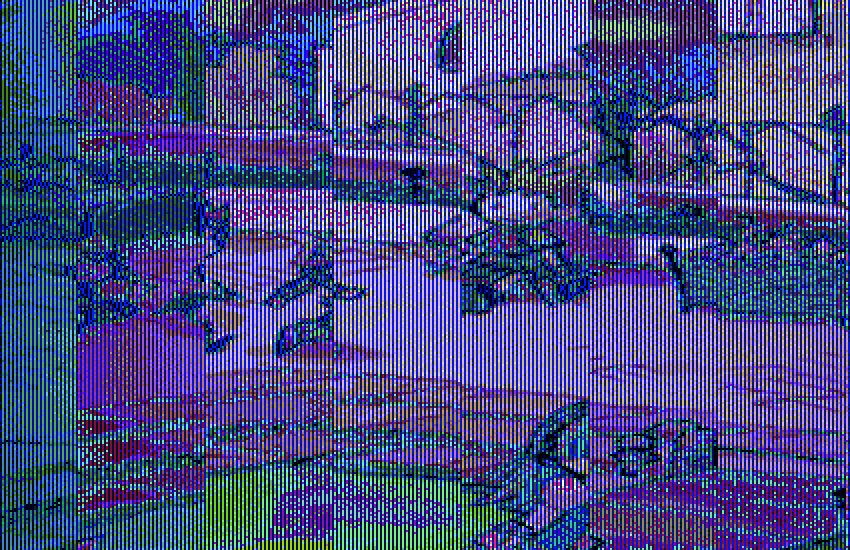
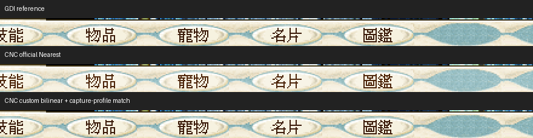
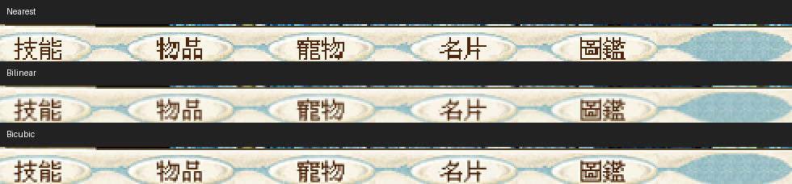
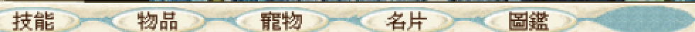

# BlueCG：cnc-ddraw 色彩、破圖與平滑選項實測（2026-11-02）

本輪找到兩個不同問題：**視窗模式自動選到 16-bit 格式，造成模式警告與彩色條紋；改為 32-bit 後可正常進入遊戲，但 OpenGL 呈現仍有另一層色彩轉換差異。** Nearest、Bilinear、Bicubic 均已用官方 DLL 完成遊戲內放大、狀態選單點擊、最小化還原及正常退出。這不是「BlueCG 完全不能用 cnc-ddraw」。

## 範圍與可重現性

- macOS／Apple M4；主螢幕 1680×945 points、Retina 2×，後段接有左側 1920×1080／1× 副螢幕。正式 shader 對照固定在主螢幕 native outer origin (260,48)。
- 僅使用隔離的 BlueCG slot 2、原版啟動器 HD[1]、`3Ddevice:1`／`GAHD`；未驗證其他 HD 尺寸、classic、`--soft3d` 或 no3d。
- 客戶端 `bluecg.exe` SHA-256：`54196345594f5f7c9e1e8b586736cc371780b1cbd3b7cfe470ba12f8c66a77c8`。
- cnc-ddraw 7.1.0.0，vendor archive SHA-256：`0b13ab89a64c9918189b1dadd449ef6ed3cb3b7b19cabd96d8adbd95505bb908`；診斷 source tag commit：`541b5de218ec3fbd6ea91e606ebfadc07c1786b0`。
- 正式 shader 測試使用未修改的官方 DLL；另編 logging DLL 僅用於追蹤格式、viewport 和輸入。沒有修改或重建 Wine engine。
- 使用實驗 runtime，但移除先前 final-blit filter 環境及 GPU helper；此處是 **cnc-ddraw 自己的 OpenGL**，不是 WineD3D renderer=gl，也不是先前的 GDI 最終 bitmap GPU 原型。

## 第一層：16-bit 模式協商

原啟動器帶入 `windowmode`。cnc-ddraw 在 `DDSCL_NORMAL` 路徑，未指定 fake mode 時，以 client 尺寸和 **16 bpp** 初始化。這可直接對照 [v7.1.0.0 dd.c](https://github.com/FunkyFr3sh/cnc-ddraw/blob/v7.1.0.0/src/dd.c) 的 `dd_SetCooperativeLevel`／`dd_SetDisplayMode`。

| 對照 | 實際 surface／結果 | 解讀 |
|---|---|---|
| OpenGL、Nearest、未指定 fake_mode | 961×721@16、64×48@16；出現模式警告，之後 RGB 彩色直條／圖像嚴重錯亂 | 沒有平滑也會壞，不能歸咎 Bilinear |
| 僅加入 `fake_mode=961x721x32` | 961×721@32、64×48@32；可登入、選角色、進入遊戲 | 32-bit 格式修正有效 |
| GDI + 同一 fake_mode | 可顯示並進入遊戲 | 初始化格式問題不等同 GL context 失敗 |

16-bit 記錄為 RGB565 masks `f800/07e0/001f`；32-bit 為 `00ff0000/0000ff00/000000ff`。32-bit 診斷實際建立 6 個 961×721 與 4096 個 64×48 surface。OpenGL context 本身成功初始化，因此黑畫面不能直接解釋為 macOS 完全不支援 GL。

證據支持「16-bit 初始化與 BlueCG 此路徑不相容」；尚未逐指令證明是哪個客戶端 buffer 寫入違反格式。沒有測試／證實 RGB555 是根因。



## 第二層：32-bit 後的亮度差

使用相同主螢幕、相同 1922×1506 原生 Retina 截圖，在不含帳號的固定底部選單區 `(220,1458,1100,1504)` 比較：

| 比較（RGB 8-bit） | 每通道平均絕對誤差 | 最大通道誤差 |
|---|---:|---:|
| 官方 CNC Nearest 1× vs 內建 DDRAW GDI 1× | 7.225791 | 23 |
| 將 CNC 像素視為 sRGB，再以 LCMS 轉入相同截圖 ICC（離線預測） | 0.039032 | 2 |
| 官方 CNC DLL＋自訂色彩 bilinear shader（實機） | **0.038801** | **2** |

固定 ROI 共 40,480 像素；此數字只衡量靜態選單外觀，不代表全畫面與動畫完全相同。



兩張 PNG 的 embedded ICC 相同，SHA-256 為 `49429d4dd70f439f6fa47a298e5ffbd280375d2cbd18708b1e05a34aafe5d219`。預測幾乎吻合，支持不同呈現路徑的色彩空間轉換差異；它與前面的 16-bit 彩條是兩個問題。

新增 [產生工具](../../../scripts/bluecg-cnc-profile-shader.py) 從 GDI 參考截圖取得 matrix／gamma，產生 BlueCG 專用 shader。它以 sRGB decode → RGB 色彩矩陣 → 目標 gamma encode 修正，硬體仍做 bilinear。產生前用 LCMS 的 17³ 色樣加 256 灰階（5169 色）獨立驗證；本機 ICC 最大誤差 1、平均 0.009673 色階。

這是**匹配本機 GDI 截圖外觀**的實驗，不是通用螢幕校色。換 ICC、顯示器或呈現鏈後必須重新驗證。工具拒絕沒有 ICC、非 single-gamma matrix profile、不合參考精度或覆蓋既有檔案。

## 平滑選項與功能矩陣

| 官方 shader | 放大字體 | 1100×791 client | 放大後選單 | 最小化還原 | 正常退出 |
|---|---|---|---|---|---|
| Nearest neighbor | 筆畫階梯、非整數倍寬度不均 | 通過 | 通過 | 通過 | 通過 |
| Bilinear | 邊緣柔化，細字稍糊 | 通過 | 通過 | 通過 | 通過 |
| Bicubic | Catmull-Rom，多鄰點重建，較銳利；可能有暈邊 | 通過 | 通過 | 通過 | 通過 |



Bicubic 類型及 filter filename 行為可見 [render_ogl.c](https://github.com/FunkyFr3sh/cnc-ddraw/blob/v7.1.0.0/src/render_ogl.c)。自訂檔名必須保留 `-bilinear.glsl` 後綴，才會啟用該版本的硬體線性取樣；只寫線性 shader 內容而檔名不符，可能仍在採用 nearest。

另以 logging DLL 實測 Windows Alt+Enter：client 1100×791 → 1024×769（viewport 1024×768）→ 1100×791，返回原視窗位置。這是 CNC 切換，不是 macOS 原生全螢幕 Space；不以此宣稱所有多螢幕全螢幕組合已修復。

Bilinear 的原始像素模板分數 9.138 超過舊門檻 8，安全腳本曾停下。實際截圖人工確認狀態面板已開；改用低頻輪廓比對正樣本 1.908、負樣本 62.265 後完成檢查。保留此次拒絕，避免把 shader 的合理像素差異當成點擊失敗。

早期 hook=0/2/3 與 GDI 點擊比較期間，使用者正在移動視窗及調整顯示器，結果受干擾。停止桌面操作、固定主螢幕後，預設 hook=4 正常，沒有足夠證據推薦改 hook 或補輸入程式碼。自訂 shader 首次啟動另遇兩個遊戲視窗，未輸入憑證即停止，兩者正常關閉後以新 phase 重跑。

## 僅供已測 HD[1] 模式的設定

將 DLL、INI、Shaders 放在隔離的 BlueCG 目錄，使用該 bottle 的 native `ddraw` override。不要改所有遊戲共用設定。

```ini
[bluecg]
windowed=true
fullscreen=false
width=0
height=0
renderer=opengl
fake_mode=961x721x32
shader=Bilinear
savesettings=0
devmode=true
maxfps=60
posx=260
posy=80
game_handles_close=true
```

`961x721` 對應本輪實際 client，不應複製到所有 classic／HD 模式。`devmode` 用於此次可調整視窗測試；位置是受控環境設定。遊戲仍從原啟動器進入，沒有繞過啟動驗證。移除 common args 的 windowmode 會被啟動器重寫，因此不算有效的原生全螢幕對照。

選用色彩匹配實驗時，從同一呈現環境的 GDI 參考 PNG 產生檔案：

```sh
python3 scripts/bluecg-cnc-profile-shader.py --capture gdi-reference.png --output bluecg-capture-bilinear.glsl
```

依賴 Pillow／ImageCms；將產物放入 `Shaders/interpolation/`，只把上例 shader 改成 `Shaders\interpolation\bluecg-capture-bilinear.glsl`。不要把本機 matrix 當作所有電腦的預設。

## 成本、限制與還原

本輪沒有進行功率、CPU 或幀時間比較；診斷 logging 與先前桌面活動不適合拿來估算成本。**不能用前輪 GPU helper 的功率數據替 CNC 下效能結論。** 此處只證明格式、濾鏡、色彩和功能結果；其他 xBR／CRT shader、D3D9、RGB555、多種 fullscreen／多螢幕切換仍未驗證。[上游 README](https://github.com/FunkyFr3sh/cnc-ddraw) 也明列 Direct3D 遊戲不受支援，不能將此模式通過外推至所有 BlueCG 渲染模式。

測試後還原紀錄與色彩 shader 實機結果見下方附錄。公開只附底部選單／登入前圖像裁圖及篩選後數據；完整遊戲畫面、帳號、原始命令列和 debug logs 保留私有。


## 附錄：色彩 shader 實機與還原結果

官方 7.1.0.0 DLL 加入自訂 `bluecg-capture-bilinear.glsl`，重新從原啟動器登入、進入相同場景。通過 961×721 → 1100×791 放大、最小化／還原、放大後開關狀態面板及標準 Yes/No 正常退出；沒有 GDI GPU helper child window。初次重複啟動及之後一次 foreground 守衛拒絕均保留紀錄；後者重新觀測唯一視窗後續接同一程序完成，沒有重複登入。



本機自訂 shader SHA-256：`f99a089f42917e31bd5890da255d67cc1b15ffb7d2ee1068099ea998864aa78a`。原始截圖沒有做事後修色；色彩修正由遊戲內 CNC shader 完成。圖片僅裁切底部字體，保留相同 ICC，不重新放大。

測試結束後，六個原始檔案（3 個 registry、啟動器 INI、common args、原版 DDRAW）逐一比對並精確還原，遊戲主程式／核心／啟動器 payload hash 未變；移除新增 CNC INI、官方 Shaders 及自訂 shader。測試遊戲與該 prefix 的 wineserver 已退出。本輪未啟動功率採集或防休眠程序，也沒有修改正式 runtime、CompatDB 或其他遊戲設定。角色正常登入／退出產生的遊戲進度不做回滾。

[去識別化測量與還原證據](assets/cnc-ddraw-2026-11-02/measurements.json) · [裁圖座標](assets/cnc-ddraw-2026-11-02/crop-provenance.json) · [工具測試](../../../tests/test-bluecg-cnc-profile-shader.py)。測試包含 LCMS 獨立參考、灰階方向、錯誤 ICC／非支援曲線、缺少 ICC、檔名與禁止覆寫，共 3 個測試通過。
