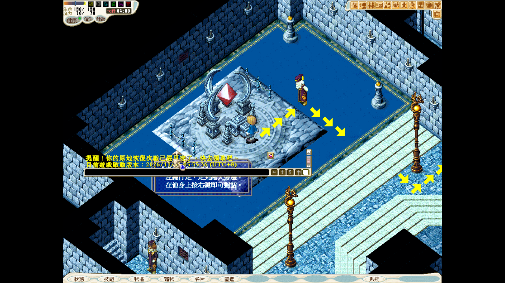
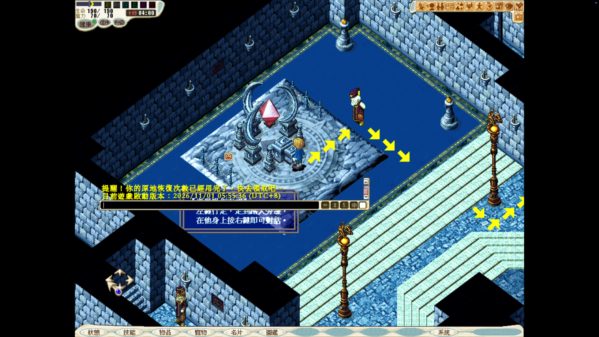
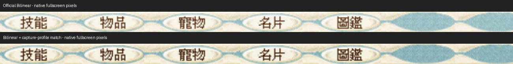
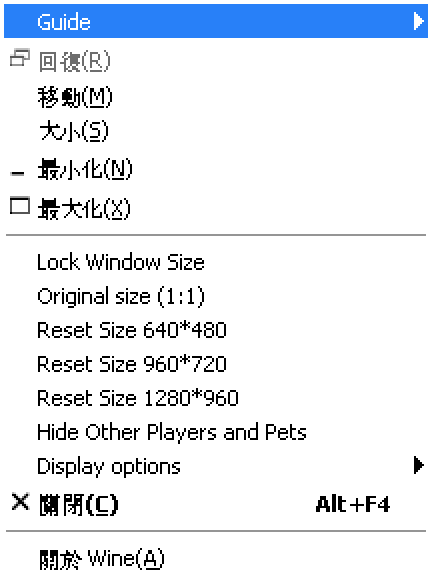
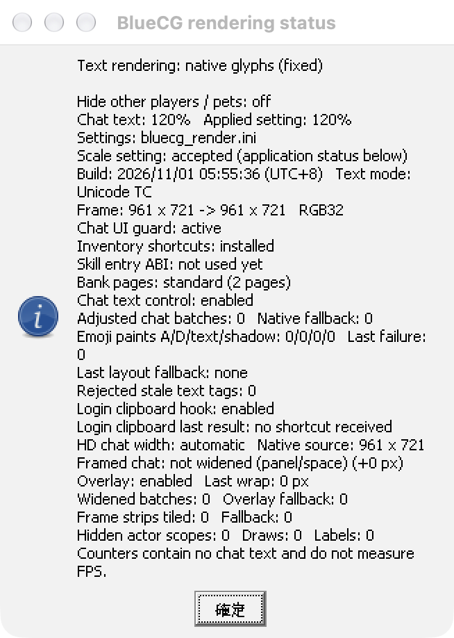

# BlueCG：cnc-ddraw 色彩、破圖與平滑選項實測（2026-11-02）

本輪找到兩個不同問題：**視窗模式自動選到 16-bit 格式，造成模式警告與彩色條紋；改為 32-bit 後可正常進入遊戲，但 OpenGL 呈現仍有另一層色彩轉換差異。** Nearest、Bilinear、Bicubic 均已用官方 DLL 完成遊戲內放大、狀態選單點擊、最小化還原及正常退出。這不是「BlueCG 完全不能用 cnc-ddraw」。

## 範圍與可重現性

- macOS／Apple M4；主螢幕 1680×945 points、Retina 2×，後段接有左側 1920×1080／1× 副螢幕。正式 shader 對照固定在主螢幕 native outer origin (260,48)。
- 僅使用隔離的 BlueCG slot 2、原版啟動器 HD[1]、`3Ddevice:1`／`GAHD`；未驗證其他 HD 尺寸、classic、`--soft3d` 或 no3d。
- 客戶端 `bluecg.exe` SHA-256：`54196345594f5f7c9e1e8b586736cc371780b1cbd3b7cfe470ba12f8c66a77c8`。
- cnc-ddraw 7.1.0.0，vendor archive SHA-256：`0b13ab89a64c9918189b1dadd449ef6ed3cb3b7b19cabd96d8adbd95505bb908`；診斷 source tag commit：`541b5de218ec3fbd6ea91e606ebfadc07c1786b0`。
- 正式 shader 測試使用未修改的官方 DLL；另編 logging DLL 僅用於追蹤格式、viewport 和輸入。沒有修改或重建 Wine engine。
- 使用實驗 runtime，但移除先前 final-blit filter 環境及 GPU helper；此處是 **cnc-ddraw 自己的 OpenGL**，不是 WineD3D renderer=gl，也不是先前的 GDI 最終 bitmap GPU 原型。

## 第一層：16-bit 模式協商

原啟動器帶入 `windowmode`。cnc-ddraw 在 `DDSCL_NORMAL` 路徑，未指定 fake mode 時，以 client 尺寸和 **16 bpp** 初始化。這可直接對照 [v7.1.0.0 dd.c](https://github.com/FunkyFr3sh/cnc-ddraw/blob/v7.1.0.0/src/dd.c) 的 `dd_SetCooperativeLevel`／`dd_SetDisplayMode`。

| 對照 | 實際 surface／結果 | 解讀 |
|---|---|---|
| OpenGL、Nearest、未指定 fake_mode | 961×721@16、64×48@16；出現模式警告，之後 RGB 彩色直條／圖像嚴重錯亂 | 沒有平滑也會壞，不能歸咎 Bilinear |
| 僅加入 `fake_mode=961x721x32` | 961×721@32、64×48@32；可登入、選角色、進入遊戲 | 32-bit 格式修正有效 |
| GDI + 同一 fake_mode | 可顯示並進入遊戲 | 初始化格式問題不等同 GL context 失敗 |

16-bit 記錄為 RGB565 masks `f800/07e0/001f`；32-bit 為 `00ff0000/0000ff00/000000ff`。32-bit 診斷實際建立 6 個 961×721 與 4096 個 64×48 surface。OpenGL context 本身成功初始化，因此黑畫面不能直接解釋為 macOS 完全不支援 GL。

證據支持「16-bit 初始化與 BlueCG 此路徑不相容」；尚未逐指令證明是哪個客戶端 buffer 寫入違反格式。沒有測試／證實 RGB555 是根因。


## 第二層：32-bit 後的亮度差

使用相同主螢幕、相同 1922×1506 原生 Retina 截圖，在不含帳號的固定底部選單區 `(220,1458,1100,1504)` 比較：

| 比較（RGB 8-bit） | 每通道平均絕對誤差 | 最大通道誤差 |
|---|---:|---:|
| 官方 CNC Nearest 1× vs 內建 DDRAW GDI 1× | 7.225791 | 23 |
| 將 CNC 像素視為 sRGB，再以 LCMS 轉入相同截圖 ICC（離線預測） | 0.039032 | 2 |
| 官方 CNC DLL＋自訂色彩 bilinear shader（實機） | **0.038801** | **2** |

固定 ROI 共 40,480 像素；此數字只衡量靜態選單外觀，不代表全畫面與動畫完全相同。


兩張 PNG 的 embedded ICC 相同，SHA-256 為 `49429d4dd70f439f6fa47a298e5ffbd280375d2cbd18708b1e05a34aafe5d219`。預測幾乎吻合，支持不同呈現路徑的色彩空間轉換差異；它與前面的 16-bit 彩條是兩個問題。

新增 [產生工具](../../../scripts/bluecg-cnc-profile-shader.py) 從 GDI 參考截圖取得 matrix／gamma，產生 BlueCG 專用 shader。它以 sRGB decode → RGB 色彩矩陣 → 目標 gamma encode 修正，硬體仍做 bilinear。產生前用 LCMS 的 17³ 色樣加 256 灰階（5169 色）獨立驗證；本機 ICC 最大誤差 1、平均 0.009673 色階。

這是**匹配本機 GDI 截圖外觀**的實驗，不是通用螢幕校色。換 ICC、顯示器或呈現鏈後必須重新驗證。工具拒絕沒有 ICC、非 single-gamma matrix profile、不合參考精度或覆蓋既有檔案。

## 平滑選項與功能矩陣

| 官方 shader | 放大字體 | 1100×791 client | 放大後選單 | 最小化還原 | 正常退出 |
|---|---|---|---|---|---|
| Nearest neighbor | 筆畫階梯、非整數倍寬度不均 | 通過 | 通過 | 通過 | 通過 |
| Bilinear | 邊緣柔化，細字稍糊 | 通過 | 通過 | 通過 | 通過 |
| Bicubic | Catmull-Rom，多鄰點重建，較銳利；可能有暈邊 | 通過 | 通過 | 通過 | 通過 |


Bicubic 類型及 filter filename 行為可見 [render_ogl.c](https://github.com/FunkyFr3sh/cnc-ddraw/blob/v7.1.0.0/src/render_ogl.c)。自訂檔名必須保留 `-bilinear.glsl` 後綴，才會啟用該版本的硬體線性取樣；只寫線性 shader 內容而檔名不符，可能仍在採用 nearest。

另以 logging DLL 實測 Windows Alt+Enter：client 1100×791 → 1024×769（viewport 1024×768）→ 1100×791，返回原視窗位置。這是 CNC 切換，不是 macOS 原生全螢幕 Space；不以此宣稱所有多螢幕全螢幕組合已修復。

Bilinear 的原始像素模板分數 9.138 超過舊門檻 8，安全腳本曾停下。實際截圖人工確認狀態面板已開；改用低頻輪廓比對正樣本 1.908、負樣本 62.265 後完成檢查。保留此次拒絕，避免把 shader 的合理像素差異當成點擊失敗。

早期 hook=0/2/3 與 GDI 點擊比較期間，使用者正在移動視窗及調整顯示器，結果受干擾。停止桌面操作、固定主螢幕後，預設 hook=4 正常，沒有足夠證據推薦改 hook 或補輸入程式碼。自訂 shader 首次啟動另遇兩個遊戲視窗，未輸入憑證即停止，兩者正常關閉後以新 phase 重跑。

## 僅供已測 HD[1] 模式的設定

將 DLL、INI、Shaders 放在隔離的 BlueCG 目錄，使用該 bottle 的 native `ddraw` override。不要改所有遊戲共用設定。

```ini
[bluecg]
windowed=true
fullscreen=false
width=0
height=0
renderer=opengl
fake_mode=961x721x32
shader=Bilinear
savesettings=0
devmode=true
maxfps=60
posx=260
posy=80
game_handles_close=true
```

`961x721` 對應本輪實際 client，不應複製到所有 classic／HD 模式。`devmode` 用於此次可調整視窗測試；位置是受控環境設定。遊戲仍從原啟動器進入，沒有繞過啟動驗證。移除 common args 的 windowmode 會被啟動器重寫，因此不算有效的原生全螢幕對照。

選用色彩匹配實驗時，從同一呈現環境的 GDI 參考 PNG 產生檔案：

```sh
python3 scripts/bluecg-cnc-profile-shader.py --capture gdi-reference.png --output bluecg-capture-bilinear.glsl
```

依賴 Pillow／ImageCms；將產物放入 `Shaders/interpolation/`，只把上例 shader 改成 `Shaders\interpolation\bluecg-capture-bilinear.glsl`。不要把本機 matrix 當作所有電腦的預設。

## 成本、限制與還原

本輪沒有進行功率、CPU 或幀時間比較；診斷 logging 與先前桌面活動不適合拿來估算成本。**不能用前輪 GPU helper 的功率數據替 CNC 下效能結論。** 此處只證明格式、濾鏡、色彩和功能結果；其他 xBR／CRT shader、D3D9、RGB555、多種 fullscreen／多螢幕切換仍未驗證。[上游 README](https://github.com/FunkyFr3sh/cnc-ddraw) 也明列 Direct3D 遊戲不受支援，不能將此模式通過外推至所有 BlueCG 渲染模式。

測試後還原紀錄與色彩 shader 實機結果見下方附錄。公開只附底部選單／登入前圖像裁圖及篩選後數據；完整遊戲畫面、帳號、原始命令列和 debug logs 保留私有。


## 附錄：色彩 shader 實機與還原結果

官方 7.1.0.0 DLL 加入自訂 `bluecg-capture-bilinear.glsl`，重新從原啟動器登入、進入相同場景。通過 961×721 → 1100×791 放大、最小化／還原、放大後開關狀態面板及標準 Yes/No 正常退出；沒有 GDI GPU helper child window。初次重複啟動及之後一次 foreground 守衛拒絕均保留紀錄；後者重新觀測唯一視窗後續接同一程序完成，沒有重複登入。


本機自訂 shader SHA-256：`f99a089f42917e31bd5890da255d67cc1b15ffb7d2ee1068099ea998864aa78a`。原始截圖沒有做事後修色；色彩修正由遊戲內 CNC shader 完成。圖片僅裁切底部字體，保留相同 ICC，不重新放大。

測試結束後，六個原始檔案（3 個 registry、啟動器 INI、common args、原版 DDRAW）逐一比對並精確還原，遊戲主程式／核心／啟動器 payload hash 未變；移除新增 CNC INI、官方 Shaders 及自訂 shader。測試遊戲與該 prefix 的 wineserver 已退出。本輪未啟動功率採集或防休眠程序，也沒有修改正式 runtime、CompatDB 或其他遊戲設定。角色正常登入／退出產生的遊戲進度不做回滾。

[去識別化測量與還原證據](assets/cnc-ddraw-2026-11-02/measurements.json) · [裁圖座標](assets/cnc-ddraw-2026-11-02/crop-provenance.json) · [工具測試](../../../tests/test-bluecg-cnc-profile-shader.py)。測試包含 LCMS 獨立參考、灰階方向、錯誤 ICC／非支援曲線、缺少 ICC、檔名與禁止覆寫，共 3 個測試通過。

## 追加實測：HD[1] 按桌面解析度無邊框全螢幕

本節補上「依桌面尺寸覆蓋、保持比例與無裁切」的驗證，限於本次單螢幕環境；不取代 macOS 原生 fullscreen Space／多螢幕驗收。

### 實際環境與設定

系統此時僅有一個顯示器：1680×945 邏輯 points、Retina backing scale 2，實際螢幕截圖 3360×1890。Wine `EnumDisplayMonitors` 同樣回報 `(0,0)-(1680,945)`；work area 為 `(0,30)-(1680,853)`。因此可以區分覆蓋整個桌面與只最大化到 work area。

保留官方啟動器 HD[1]、961×721／32-bit、相同遊戲與官方 cnc-ddraw 7.1.0.0 DLL。這次只在隔離 slot 2 加上：

```ini
[bluecg]
windowed=true
fullscreen=false
width=0
height=0
renderer=opengl
fake_mode=961x721x32
shader=Bilinear
maintas=true
boxing=false
adjmouse=true
toggle_borderless=true
toggle_upscaled=false
savesettings=0
devmode=true
maxfps=60
posx=260
posy=80
game_handles_close=true
```

從一般視窗登入後，實際送出 Windows Alt+Enter。`toggle_borderless=true` 令 CNC 在一般視窗與桌面尺寸的無邊框模式間切換；`maintas=true` 使用來源尺寸比例、`boxing=false` 允許非整數倍平滑放大，`adjmouse=true` 調整滑鼠座標。`width=height=0`，沒有硬填 1680×945；全螢幕尺寸由 CNC 讀取目前桌面模式。這是 CNC 無邊框全螢幕，不使用 macOS 綠色按鈕／Space，也沒有改系統解析度。

### 比例、黑邊與「多 1 點」的檢查

- 一般視窗 native outer bounds：`(260,48,961,753)`；client 961×721。
- 全螢幕 native／Win32 client：`(0,0,1680,946)`；覆蓋桌面，不受 menu／Dock work area 限制。
- 遊戲 viewport：**1260×945 points**，左右各 **210 points** 黑邊；Retina 對應遊戲區 2520×1890、左右各 420 px。
- 來源比例 961:721 與 viewport 1260:945 的差異約 0.035%，是寬度取整造成；未強制拉伸到 16:9，也未裁掉左右來源內容。
- 實際螢幕截圖保留上方左右 HUD 及完整底部選單。來源寬高都落入可見 viewport，沒有把黑邊裁除來假裝填滿螢幕。

**1680×946 並不代表裁掉 1 點遊戲畫面。** 上游 `dd.c` 為避免 OpenGL 自動進入 exclusive mode，在算完 viewport 後執行 `render.height++` 與 `opengl_y_align=1`；`render_ogl.c` 將 viewport 向 GL 底部座標上移 1。實測 window capture 為 3360×1892，最後 y=1890、1891 兩列在全畫布皆為純黑；實際螢幕為 3360×1890，遊戲內容正好結束於可見的 y=1889。多出的只是螢幕外黑色避讓列，沒有遊戲內容被截掉。

### 操作驗收

| 組別 | 真實 Alt+Enter 往返 | 全螢幕最小化／還原 | 左下狀態／右下系統 | 回切後滑鼠 | 正常退出 |
|---|---|---|---|---|---|
| 官方 Bilinear | 3 次完整往返 | 3 次；另測一般視窗 1 次 | 兩端面板均實際開關 | 通過 | 返回視窗後確認退出 |
| 本機色彩 Bilinear shader | 1 次完整往返，再進入全螢幕 | 2 次 | 兩端面板均實際開關 | 通過 | **直接從全螢幕叫出確認框並退出** |

兩組皆使用官方未修改 DLL，SHA-256 `85e0f7d530dfda134793a57cb3e76b0287dcc96892ee57162dd68f47283b03a9`，loader trace 確認載入 native ddraw；沒有依 renderer 設定名稱猜測後端。色彩 shader 組的 ICC 與前輪相同，回切固定字體 ROI 也為 MAE=0、最大差=0。

官方 Bilinear 每次返回的 native bounds 均為 `(260,48,961,753)`、client 961×721，沒有尺寸或位置累積漂移。固定底部文字 ROI `(220,1464,1100,1500)` 共 31,680 原生像素，三次回切與起始畫面 **MAE=0、最大通道差=0**。較寬的初始 ROI 含選單上下動畫邊緣，差異約 3.65–3.83；排除那些非文字邊緣後才得到上述固定文字結果，不把動畫差異當成字體退化。

全螢幕左下「狀態」實際點位為 `(263,931)` points，右下「系統」為 `(1244,931)`，皆依新截圖和黑邊換算；兩者均出現對應面板並可關閉。重複狀態面板的輪廓正控制分數 0、關閉負控制約 76；返回一般視窗後 `(40,741)` 也可再次開啟狀態面板。系統選單只做開關，沒有更改音樂、繪圖或其他設定。

全螢幕後 Wine 原生視窗 layer 為 26，先前僅接受 layer 0 的點擊守衛拒絕了一次操作，沒有送出點擊。私有測試 helper 改為辨識已觀測的 0／26 層，仍檢查精確 PID／window ID／標題、前景與點位；只排除同程序、同層、空標題且不超過 32×32 points 的小型游標視窗，才完成原生滑鼠驗證。這是測試工具適配，不是修改遊戲的 input hook。

### 實際螢幕與原生字體截圖

下列整個螢幕截圖保留原始 **3360×1890** 像素及 ICC，沒有縮放、裁掉黑邊或事後修色。原始檔可點開檢查最上方 HUD、完整底部選單與左右黑邊；貼在頁面內時瀏覽器可能縮小顯示。







[全螢幕狀態面板（僅遮蔽角色名稱）](assets/cnc-ddraw-fullscreen-2026-11-02/bilinear-status-fullscreen-redacted.png) · [第三次返回視窗（僅遮蔽原生標題列）](assets/cnc-ddraw-fullscreen-2026-11-02/bilinear-windowed-return-redacted.png) · [直接從全螢幕正常退出的確認框](assets/cnc-ddraw-fullscreen-2026-11-02/colormatched-fullscreen-exit-dialog.png)。

[兩組完整功能／幾何／還原數據](assets/cnc-ddraw-fullscreen-2026-11-02/measurements.json) · [原始截圖 hash、裁圖及遮蔽範圍](assets/cnc-ddraw-fullscreen-2026-11-02/provenance.json)。

### 範圍與還原

兩組均以標準確認對話完成遊戲退出，之後才停止本輪獨立 prefix 的 wineserver，沒有強制結束遊戲。六個原始檔案（3 個 registry、原版 DDRAW、啟動器 INI 及 common args）均與本輪開始前 hash 精確一致；遊戲主程式／核心／啟動器 payload hash 未變。新增 CNC INI、官方 Shaders 與自訂 shader 核對後移除。最終檢查沒有本輪遊戲、啟動器或 wineserver 殘留，仍為同一個顯示器；沒有建立功率採集或防休眠程序。

此次只編譯私有 macOS 測試點擊 helper，沒有 Wine／cnc-ddraw 產品程式碼修改、正式 runtime 安裝、全域 registry 變更、CompatDB 規則或其他遊戲設定變更。角色正常登入／退出產生的進度不回滾。

本節證明的是目前 **HD[1]＋單一 1680×945／Retina 2× 桌面**的 CNC borderless 路徑。其他 HD／classic 模式、解析度即時切換、混合 Retina 多螢幕、macOS fullscreen Space、exclusive display mode 尚未由此驗收。這輪沒有 CPU、功率或幀時間排名；保持比例／平滑／功能通過不代表已證明效能較佳。


## 追加分析：官方 DDRAW、頂部 ☰ 與縮放選單的分工

本輪使用相同 `bluecg.exe`／`bluecg.dll` 與隔離 slot 2，分別以官方 native DDRAW、Wine builtin DDRAW 啟動 HD[1]；都停在登入前，沒有輸入帳密或進入世界。只改程序限定的 DLL override，官方檔案保持相同。loader trace 確認官方組載入 native DDRAW（同時也見 builtin）、負控制只有 builtin，沒有誤把檔案存在當成實際載入。

**頂部「☰」由遊戲核心 `bluecg.dll` 提供，並非必須依賴官方 DDRAW。** 原生視窗 class 為 `BlueCG.TitleSettings.R23`，按鈕 WndProc 與 class proc 都定位於 `bluecg.dll +0x178e40`；遊戲主視窗目前的 WndProc 為 `bluecg.dll +0x1783e0`。☰ 是獨立的 30×22 points 小型頂層視窗，主遊戲 window capture 可能不包含它，不能用截圖中沒看到按鈕判定功能不存在。

為讀取程序內的 HMENU 與 WndProc，使用限於這個隔離遊戲 GUI thread 的暫時 `WH_CALLWNDPROC` 觀察 DLL，藉 `WM_NULL` 讀取資料後同步 `UnhookWindowsHookEx`。沒有修改官方 DLL 或遊戲檔案；觀察工具不作為產品補丁安裝。外部程序直接 `GetSystemMenu` 的空結果不列為「沒有選單」的證據。

### 模組歸屬與對照結果

- 官方 DDRAW：67,072 bytes，SHA-256 `c7ba81e067690fc0d77a31c4d7a6ad4af1d0b84255275ca4974971a70394c0c7`，內含標記 `ddraw-rtx4090-r10-20260927`、三種 Reset Size 字串及系統選單／GDI stretch 相關匯入，確實有官方附加處理。
- 目前核心：SHA-256 `832fd1de73783849251a1b397f082d289feb957eaabac1473a77ce4a28d8ed1a`；診斷框回報 build `2026/11/01 05:55:36 (UTC+8)`。
- 官方與 builtin 組的系統選單，去除聊天百分比文字變動後，項目 ID／階層／文字完全相同。包含原尺寸、三種 Reset Size、鎖定大小、Fit screen、聊天字體及 Rendering status；**移除官方 native DDRAW 的載入依賴，不會令這些選單消失。** 不能據此推論官方 DDRAW 完全無功能，也不代表 CNC 下的每個選單動作已通過。

官方公告另將 ☰、鎖定大小與聊天設定列為 2026/09/28 客戶端項目，並在 09/30 說明移除 Keep original aspect ratio、保留 Fit screen 等操作，與本輪觀察一致。[官方說明](https://www.bluecg.net/new/BlueCG_Launcher.html)

### 官方組實際尺寸結果

以下皆為同一 HD[1] 來源，透過已觀察到的選單 command 逐一執行；不是切換遊戲啟動模式：

| 選項 | 命令 ID | Wine client 實測 | 意義 |
|---|---:|---|---|
| Original size (1:1) | 8064 | 961×721 | 回到目前來源的邏輯尺寸 |
| Reset 640×480 | 8080 | 640×480 | 縮小呈現視窗，沒有改為一般版資源 |
| Reset 960×720 | 8096 | 961×721 | 此環境量到的結果含一點差異 |
| Reset 1280×960 | 8112 | 1280×791 | 高度受目前 Wine work-area 限制；不能視為已得到指定的 4:3 大小 |
| Fit screen (keep ratio) | 29216 | 1052×789 | 保持 4:3 並配合可用桌面範圍；仍是有標題列的一般視窗 |
| 再次 Original size | 8064 | 961×721 | 成功返回原尺寸 |

沒有將 Reset 1280 的非等比結果外推為 Windows 上相同行為，也沒有把 Fit screen 當作 CNC 的無邊框全螢幕。這組選單沒有觀察到整張 bitmap 的 Bilinear／HALFTONE 切換項目；聊天字體大小也不等於整張圖像的平滑取樣。





診斷框回報 `Frame: 961 x 721 -> 961 x 721 RGB32`，並顯示 `bluecg_render.ini`、聊天比例及文字繪製計數。**這證明核心當前有 RGB32 frame 路徑，並非直接量到 DirectDraw surface 的 pixel format。** 因此給官方的後續建議應是核對 RGB32 frame 與 DirectDraw 初始化／surface 格式協商，不應宣稱官方完全沒有 32-bit 支援或只缺一個 SetDisplayMode 呼叫。

### 與 CNC 整合的影響及還原

- 既有 ☰ 選單與 CNC 都會影響視窗尺寸；CNC 整合還應補測從 ☰ 執行 Reset／Fit／Lock 時，viewport、比例和滑鼠是否同步。之前 Alt+Enter 通過不等於這些入口全通過；目前沒有聲稱已重現兩者衝突。
- 先前已定位的最後 bitmap `COLORONCOLOR` 拉伸，不能因為有「保持比例」選項就視為已改成平滑取樣。比例、像素插值與色深是三個不同問題。
- 官方與 builtin 兩組均標準退出；六個原檔／registry 精確還原，19 個小檔案快照中有變更的 4 個已還原。本輪新建的 `bluecg_render.ini` 在私有備份後移除；遊戲 payload hash 未變，未留下觀察 hook 或新增 CNC 檔案，沒有改其他遊戲設定。

[去識別化模組、選單、尺寸與還原證據](assets/official-menu-2026-11-02/evidence.json) · [截圖來源與裁切](assets/official-menu-2026-11-02/provenance.json)。這輪沒有進行效能／功率量測。
