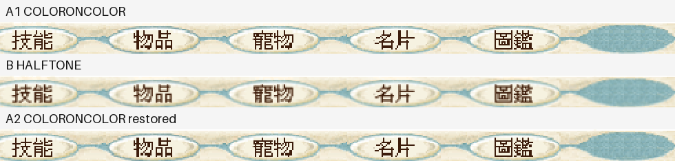
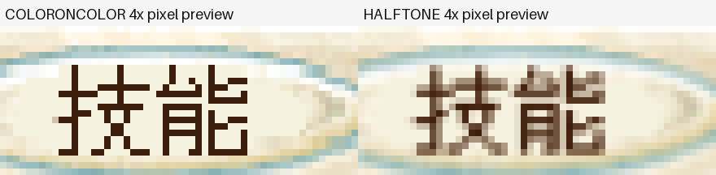

# BlueCG 最終 bitmap HALFTONE 畫質與成本實測

日期：2026-11-01，Asia/Taipei。追蹤 [CyderBits #15](https://github.com/dspp779/CyderBits/issues/15)；實驗引擎見 [Draft PR #7](https://github.com/dspp779/cyder-wine-engine/pull/7)。

## 結論

在本次 BlueCG 單開、GDI、1100×791 client 的實際遊戲中，將最後整張 bitmap 的 `COLORONCOLOR` 改為 `HALFTONE`，**能讓底部選單的階梯邊緣變柔和，但文字與 UI 也會變模糊，且增加 CPU 成本**。關閉開關後，五個選單按鈕的 45,080 個原生像素與首輪完全一致。

同步功率採樣的 A→B→A 對照，以兩個 A 的平均為基準，HALFTONE 遊戲 CPU 增加 **22.18 個百分點（相對 +41.8%）**，晶片 Combined Power 變化 **+2.853 W（相對 +93.0%）**。此處 Combined 是整顆晶片 CPU＋GPU＋ANE 的估計值，包含其他程序，不能當成 Wine 專屬功率或插座整機功率。

這是局部實驗開關，**預設關閉**，尚未安裝正式引擎、加入 CompatDB 或改動其他遊戲設定。本輪選擇 HALFTONE；GPU 線性呈現尚未實作，也沒有列入效能排名。

## 測試條件

| 項目 | 固定條件 |
|---|---|
| 主機 | Apple M4、10 核、16 GiB、macOS 27.2；AC 電源 |
| 顯示 | 1680×945 points，backing scale 2，60 Hz；Wine RetinaMode 關、96 DPI |
| 遊戲 | 同核心、資源與角色，召喚之間靜態場景；HD[1]、3Ddevice:1、GAHD、system／MingLiU 字體 |
| 圖形 | `WINE_D3D_CONFIG=renderer=gdi`、`ddraw=b`；沒有變更 soft3d、透明設定或省電模式 |
| 原始 bitmap | 961×721；Alt+Enter 後核對並統一為 1100×791 client |
| 變因 | 同一個隔離 runtime，僅對 B 設 `CYDER_BLUECG_BLIT_FILTER=halftone`；A 不設該環境變數 |
| 流程 | 每組重新啟動並登入，確認場景、Alt+Enter、幾何與模組／核心身分，先截圖，再暖機 60 秒、正式採樣 300 秒，最後正常退出 |
| 重複 | 先做 CPU-only A→B→A，再做同步 CPU／功率 A→B→A，共六次遊戲啟動；未把不同採集開銷的兩輪混算 |
| CPU | 逐程序累積 CPU time 差分，每 5 秒一次、每組 60 筆；100%＝一個核心；遊戲、啟動器與 wineserver 分列 |
| 功率 | 完整 powermetrics，5 秒取樣，cpu_power／gpu_power／tasks 與 process energy；排除正式窗口邊界各 1 秒及跨界區間 |
| 畫面更新 | 同一 HWND、同一執行緒、全 client 的成功 SRCCOPY StretchBlt，來源／目的尺寸與 mode 固定；以 QPC／UTC anchor 對齊正式窗口 |
| 觀察器 | 三組都開相同 GDI／surface 診斷；正式窗口不操作 UI、截圖或執行建置。功率輪皆維持相同 powermetrics 採集 |
| 品質檢查 | 六組正式窗口前景錯配 0、thermal state 峰值 0、低耗電模式全為 false；功率輪開始前確認沒有活躍畫面共享高負載程序 |

核心 SHA-256：`832fd1de73783849251a1b397f082d289feb957eaabac1473a77ce4a28d8ed1a`。
只替換隔離 runtime 的 i386／x86_64 `gdi32.dll`，其餘檔案逐一 hash 比對相同。模組 hash、各組正式起點、完整統計與設定還原結果見 [evidence.json](assets/final-blit-2026-11-01/evidence.json)；機器可讀表格見 [comparison.csv](assets/final-blit-2026-11-01/comparison.csv)。

## 底部選單畫質

下圖依序是原始 A1、HALFTONE、還原 A2。每列都是 980×46 原生像素裁圖，截圖本體為 2200×1646；ROI 為 `(220,1598)–(1200,1644)`。只比較固定按鈕，避開角色、聊天及動態場景。

原圖連結：[原始 A1](assets/final-blit-2026-11-01/nearest-a1.png)、[HALFTONE](assets/final-blit-2026-11-01/halftone.png)、[還原 A2](assets/final-blit-2026-11-01/nearest-a2.png)。頁面可能再次縮圖，請用 100% 顯示原圖檢視。

以下只用 nearest 將既有截圖放大 4 倍，供看清取樣後的像素；沒有對圖再做平滑處理。

| 檢查 | 實際結果 |
|---|---|
| 原始取樣 | 筆畫邊緣清楚，但非整數放大使行列重複，呈現粗細不均與階梯感 |
| HALFTONE | 邊緣混合、階梯感減少；筆畫與細框較軟，沒有恢復新的字體解析度 |
| A1 對 A2 | RGB MAE 0，差異像素 0／45,080，證明切換可逆 |
| A1 對 HALFTONE | RGB MAE 11.082，差異像素 38,100／45,080；這是輸出變化指標，不是品質分數 |
| 幾何比例 | 三組目的尺寸相同；HALFTONE 沒有修正寬倍率 1.14464×、高倍率 1.09709× 不一致造成的比例變形 |

## 同步 CPU 與畫面更新比較

單位：CPU 為單核心百分比；耗時與間隔為 ms；提交率為次／秒。

| 組別 | mode | 遊戲 CPU | 啟動器 CPU | wineserver CPU | blit 中位耗時 | 提交率 | 間隔中位 | P95 | P99 | >50 ms 次數 |
|---|---:|---:|---:|---:|---:|---:|---:|---:|---:|---:|
| 原始 A1 | 3 | 52.94% | 0.16% | 0.49% | 0.447 | 60.001 | 17.943 | 23.745 | 25.682 | 0 |
| HALFTONE B | 4 | 75.29% | 0.14% | 0.48% | 5.191 | 59.992 | 18.214 | 23.442 | 25.682 | 0 |
| 還原 A2 | 3 | 53.27% | 0.15% | 0.48% | 0.453 | 59.994 | 17.694 | 23.876 | 26.247 | 1 |

這些間隔是**完整畫面 GDI API 提交間隔**，不是 GPU 完成、顯示掃描或輸入延遲，也不保證每次提交含新動畫幀。blit 探針區段包含 filter 條件與取樣準備，不包含最後 DC 狀態還原及 CSV 緩衝刷出；三組使用同一探針。

## 晶片功率比較

按完整區間長度加權的平均 ± 標準差，單位 W；以完整取樣總時間作變異數分母，表示窗口內波動，不是平均值的信賴區間。

| 組別 | CPU | GPU | ANE | Combined CPU＋GPU＋ANE | 完整樣本 | 覆蓋秒數 | 有 counter 警告樣本 |
|---|---:|---:|---:|---:|---:|---:|---:|
| 原始 A1 | 2.782 ± 0.639 | 0.349 ± 0.021 | 0.000 ± 0.000 | 3.131 ± 0.643 | 58 | 292.03 | 13 |
| HALFTONE B | 5.567 ± 0.488 | 0.354 ± 0.014 | 0.000 ± 0.000 | 5.922 ± 0.491 | 58 | 292.08 | 10 |
| 還原 A2 | 2.653 ± 1.155 | 0.354 ± 0.016 | 0.000 ± 0.000 | 3.007 ± 1.156 | 58 | 292.07 | 6 |

保留原始輸出的 `Second underflow`／invalid counter 警告並逐組列數，沒有刪除後偽裝成無警告採樣。此輪只有一組功率 A→B→A，數值是該場景及採集環境下的晶片估計；不外推三開，也不把全部差值分配給 Wine。

程序 Energy Impact 另列如下。它是 powermetrics 指標，**不是 W 或 J**，不與上表加總。

| 組別 | 遊戲 Energy Impact | 啟動器 Energy Impact | wineserver Energy Impact |
|---|---:|---:|---:|
| 原始 A1 | 2191.37 (58 筆) | 2.58 (58 筆) | 7.14 (58 筆) |
| HALFTONE B | 5066.25 (58 筆) | 2.84 (58 筆) | 9.16 (58 筆) |
| 還原 A2 | 2139.53 (58 筆) | 2.49 (58 筆) | 6.81 (58 筆) |

背景程序 CPU 另外核對如下，來源同為完整 powermetrics 區間。非此 runtime 程序總和排除監測器辨識的全部 Wine／wineserver PID；它包含 WindowServer 與採集／控制程序。這能檢查背景負載是否明顯改變，但仍不能把整顆晶片的瓦數歸給單一程序。

| 組別 | 非此 runtime 程序總 CPU | 其中 WindowServer CPU |
|---|---:|---:|
| 原始 A1 | 83.54% | 39.66% |
| HALFTONE B | 74.75% | 38.94% |
| 還原 A2 | 74.31% | 39.87% |

## 第一輪 CPU 重複驗證

第一輪沒有啟動新的 powermetrics，三組觀察器設定仍一致。它提供 CPU 與畫質重複驗證，不能拿來補功率數字。

| 組別 | mode | 遊戲 CPU | 啟動器 CPU | wineserver CPU | blit 中位耗時 | 提交率 | 間隔中位 | P95 | P99 | >50 ms 次數 |
|---|---:|---:|---:|---:|---:|---:|---:|---:|---:|---:|
| 原始 A1 | 3 | 53.66% | 0.16% | 0.49% | 0.449 | 60.001 | 17.332 | 23.756 | 25.762 | 0 |
| HALFTONE B | 4 | 74.60% | 0.14% | 0.49% | 5.140 | 59.994 | 18.219 | 23.166 | 24.976 | 1 |
| 還原 A2 | 3 | 53.84% | 0.15% | 0.50% | 0.440 | 60.000 | 18.042 | 23.488 | 25.106 | 0 |

以兩個 A 平均 53.75% 為基準，HALFTONE 增加 20.85 個百分點（相對 +38.8%）。不能把這個 CPU 差異直接換算為程序瓦數。

分析工具：[逐程序 CPU](../../../scripts/bluecg-benchmark.py)、[GDI 提交區間](../../../scripts/bluecg-present-frames.py)、[完整功率輸出分析](../../../scripts/bluecg-power-summary.py)。其離線測試驗證時段邊界、單位、缺資料與重複 GPU 欄位等情境；沒有將程序 Energy Impact 轉成瓦數。

## 引擎開關與實作範圍

[Engine PR #7](https://github.com/dspp779/cyder-wine-engine/pull/7) 依序提交診斷探針及 HALFTONE 實驗。開關只在 basename 為 `bluecg.exe`，且 SRCCOPY、完整自有視窗 client、正尺寸來源、確實縮放時生效。memory DC、局部矩形、EMF 與列印路徑不套用。

呼叫底層 blit 前暫設 `HALFTONE` 與 brush origin `(0,0)`，完成或失敗後都還原 stretch mode／origin，保留底層結果與 LastError。紀錄直接觀察 mode 3→4→3。此版 Wine 的常用 32-bit DIB HALFTONE 分支在 CPU 做雙線性插值，對應本次增加的 CPU 工作；它沒有把最後一步變成 GPU 濾波。

GPU 方案需另外處理最終 DIB 上傳、線性 sampler、視窗呈現及同步；只設 renderer=gl 不會改變 BlueCG 原本的最後 GDI bitmap 拉伸，不能視為 GPU 線性組。

## 測試與還原

兩架構 GDI32 PE 增量編譯成功；HALFTONE 行為測試覆蓋 opt-in／錯誤 exe、owner、完整 client、memory DC、ROP、列印／EMF、DC mode／origin 還原、成功／失敗 LastError、有效 mode 診斷與 patch 正反套用。DirectDraw／GDI 診斷、build script、manifest、版本與 minOS 測試通過。

完整 `tests/run.sh` 在既有 media-toolchain 整合測試停止：macOS 27 CLT 的 `libxcrun` 缺 x86_64 slice。另以單次 DEVELOPER_DIR 指向已安裝 Xcode 重試，仍因尚未接受 Xcode license 而停止，未代為接受授權或更改系統設定。GL profiling runtime control 未指定建置 runtime 時為 skip。這不是完整 configure／build／release 驗收；未為了讓測試通過而更改系統工具鏈。

所有測試遊戲均正常關閉，prefix wineserver 已等待退出；registry 精確還原，遊戲核心與啟動器 INI 未變。防休眠只使用本輪有時限的程序，完成後停止。使用者已在原 Terminal 按 Ctrl+C 停止 powermetrics，並核對該採集程序已退出；完整輸出保留，不改 sudo 或系統休眠政策。已另外封存含三組完整窗口的原始功率輸出，公開 evidence 只附 SHA-256 與彙總，不公開其他程序的完整紀錄。

相關：[原始縮放根因](scaling-root-cause-2026-11-01.zh-TW.md)。
