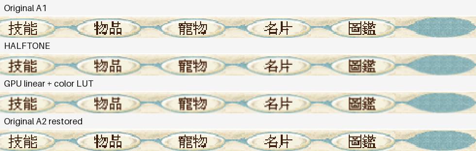
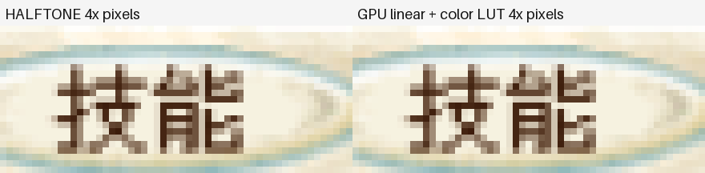

# BlueCG GPU 線性採樣畫質與成本實測

日期：2026-11-02，Asia/Taipei。追蹤 [CyderBits #15](https://github.com/dspp779/CyderBits/issues/15)。引擎：[Draft PR #8](https://github.com/dspp779/cyder-wine-engine/pull/8)，commit `5be3824`；提交區間分析器：`a98b707`。

後續三開結果見 [三開比較與生命週期驗證](triple-gpu-2026-11-02.zh-TW.md)；兩輪功率分開，三開戶外場景有漂移限制。

## 結論

**這台 M4、單開 GDI 與本次放大場景下，GPU 線性採樣原型能以接近 HALFTONE 的底部文字畫質，降低平滑放大的 CPU 與晶片估計功率。** GPU 組遊戲 CPU 平均 41.18%、Combined 2.045 W；HALFTONE 為 73.99%、5.722 W，分別降低 **44.3%** 與 **64.3%**。

兩個原始組平均為 CPU 53.52%、Combined 2.585 W。GPU 組相對它們也降低 CPU 23.1%、晶片估計功率 20.9%。這是完整呈現路徑的成本比較，包含 source copy、上傳、GPU 取樣、色彩查表、context 切換與 swap，不把差距全部歸因於單一取樣指令。

GPU 與 HALFTONE 的固定選單 ROI 平均 RGB 差異 **0.396／255**、最大通道差異 **3**；輸出近似，沒有聲稱逐像素完全相同。原始 A1 與回測 A2 的 45,080 個 ROI 像素完全一致。

三路提交率都約每秒 60 次。GPU 提交間隔 P95 為 24.803 ms，HALFTONE 為 23.268 ms；這輪沒有證明 GPU 的顯示延遲或幀節奏更好。GPU 與 HALFTONE 正式窗口都沒有 >50 ms 提交間隔。

Combined 是整顆晶片 CPU＋GPU＋ANE 的估計，包含其他程序，**不是 Wine 專屬瓦數或插座整機功率**。本輪是一次 A→HALFTONE→GPU→A，每組 300 秒，不外推三開、其他模式、Retina 設定、硬體或其他遊戲。

## 控制條件與實作

| 項目 | 本輪條件 |
|---|---|
| 主機 | Apple M4、10 核、16 GiB、macOS 27.2（26B123）、AC 電源 |
| 顯示 | 1680×945 points、backing scale 2、60 Hz；Wine RetinaMode 關、96 DPI |
| 遊戲 | 同一 EXE／核心／資源／角色；召喚之間，HD[1]、3Ddevice:1、GAHD、system／MingLiU 字體 |
| Source renderer | 四組均 `WINE_D3D_CONFIG=renderer=gdi`、`ddraw=b`，沒有修改 soft3d、透明設定或其他遊戲規則 |
| 尺寸 | 原始 bitmap 961×721；登入後真正 Alt+Enter，核對並統一 client 為 1100×791；原生 PNG 2200×1646 |
| 順序 | 原始 A1 → CPU HALFTONE → GPU 線性＋色彩 LUT → 原始 A2 |
| 每組 | 重新啟動與登入、確認身分及場景、先截圖、暖機 60 秒、正式 300 秒，再正常退出 |
| CPU | 累積 CPU time 差分，5 秒一次、每組 60 筆；100%＝一個核心，遊戲／啟動器／wineserver 分開 |
| 功率 | 同一完整 powermetrics 採集，cpu_power／gpu_power／tasks、process energy、5 秒取樣；排除兩端各 1 秒及跨界區間 |
| 畫面更新 | 同一 HWND／執行緒、成功且完整 client 的 SRCCOPY 提交，source／destination／API 類型固定；用 QPC／UTC anchor 對齊窗口 |
| 觀察器 | 相同 GDI、GL／surface 觀察器與 CPU 監測；正式窗口不操作 UI、不截圖、不建置。分析與建置在窗口外執行 |
| 品質檢查 | 四組前景錯配 0、thermal state 峰值 0、低耗電模式均 false；沒有活躍遠端畫面共享高負載程序 |

核心 SHA-256：`832fd1de73783849251a1b397f082d289feb957eaabac1473a77ce4a28d8ed1a`。四組 EXE、核心、啟動器與遊戲 DDRAW 檔案 hash 均一致。隔離 runtime 比對 1,857 個檔案，只有兩架構 GDI32 PE 改變，host 模組未變；GPU 組另載入本輪 helper 與 LUT。沒有安裝或替換正式引擎，也沒有新增 CompatDB 規則。

完整去識別化數據與原始檔 hash：[evidence.json](assets/gpu-linear-2026-11-02/evidence.json)；可讀取表格：[comparison.csv](assets/gpu-linear-2026-11-02/comparison.csv)。完整原始功率與未裁切畫面保留於私有測試目錄。

## 字體畫質

四列依序是原始 A1、HALFTONE、GPU 線性＋LUT、原始 A2。每列 980×46 原生像素，ROI `(220,1598)–(1200,1644)`，只含固定五個按鈕，避開角色與聊天。圖片保留共同 ICC profile；請以 100% 原圖檢視，避免網頁縮圖再次插值。

原圖：[原始 A1](assets/gpu-linear-2026-11-02/original-a1.png)、[HALFTONE](assets/gpu-linear-2026-11-02/halftone.png)、[GPU 線性](assets/gpu-linear-2026-11-02/gpu-linear.png)、[還原 A2](assets/gpu-linear-2026-11-02/original-a2.png)。

以下以 nearest 將既有截圖放大四倍，只顯示現有像素，沒有再做平滑。

| 檢查 | 結果 |
|---|---|
| 原始 | 筆畫邊緣硬，非整數複製行列仍會形成粗細不均與階梯感 |
| HALFTONE／GPU 線性 | 邊緣混合較柔和，兩者同樣有 bitmap 模糊感，沒有新增字形解析度 |
| HALFTONE 對 GPU | RGB MAE 0.396，最大通道差 3，差異像素 32,964／45,080；非零像素數不是品質分數 |
| 原始 A1 對 A2 | RGB MAE 0，差異像素 0／45,080 |
| Retina 二次取樣 | 四組 ROI 的 11,270 個原生 2×2 block 全部內部相同，沒有額外的第二次平滑 |
| 幾何 | 寬倍率 1100/961≈1.14464、高倍率 791/721≈1.09709；GPU 濾波沒有修正寬高比例不一致造成的形變 |

## CPU 與提交間隔

CPU 為單核心百分比，耗時／間隔為 ms，提交率為次／秒。

| 組別 | 遊戲 CPU | 啟動器 CPU | wineserver CPU | blit 區段中位 | 提交率 | 間隔中位 | P95 | P99 | >50 ms |
|---|---:|---:|---:|---:|---:|---:|---:|---:|---:|---:|
| 原始 A1 | 53.47% | 0.16% | 0.49% | 0.449 | 59.989 | 17.098 | 23.643 | 25.614 | 1 |
| HALFTONE | 73.99% | 0.14% | 0.49% | 5.118 | 59.993 | 18.219 | 23.268 | 25.017 | 0 |
| GPU 線性＋色彩 LUT | 41.18% | 0.14% | 0.51% | 2.527 | 60.001 | 18.292 | 24.803 | 26.364 | 0 |
| 原始 A2 | 53.57% | 0.15% | 0.48% | 0.453 | 60.001 | 18.033 | 23.619 | 25.487 | 0 |

此處的「幀時間」代理是 **CPU 側完整畫面提交的 API 回傳間隔**，沒有取得跨 GDI／GPU 一致的 scanout 或 GPU 完成量測，不能由它推算輸入延遲或真正顯示 FPS。GPU 的 API 區段含等待、上傳、呈現與 context 還原；GDI 後續 surface flush 不全包含在 blit 區段，所以 elapsed ms 不能直接換成程序 CPU 百分比。

GDI 使用 profile `api=2`，HALFTONE 暫設 DC mode 4；成功 GPU 提交為 `api=3`，其 `stretch_mode=3` 仍描述呼叫者 DC，實際 GPU sampler 由 helper 的 `GL_LINEAR` 與查詢結果驗證。本輪先檢查完整 client stream 只有一種預期 API，再由分析器核對尺寸、mode、錯誤與窗口覆蓋。命令列可先用 `--list` 檢查，再以 `--api 3` 抽取 GPU 組；未混算 GDI 回退。

## 晶片功率與程序 Energy Impact

按完整區間長度加權的平均 ± 標準差，單位 W。以完整時間作變異數分母；標準差表示窗口內波動，不是平均值信賴區間。

| 組別 | CPU Power | GPU Power | ANE | Combined | 完整樣本 | 覆蓋秒數 | counter 警告樣本 |
|---|---:|---:|---:|---:|---:|---:|---:|---:|
| 原始 A1 | 2.431 ± 0.281 | 0.178 ± 0.012 | 0.000 ± 0.000 | 2.609 ± 0.291 | 59 | 295.81 | 2 |
| HALFTONE | 5.539 ± 0.305 | 0.184 ± 0.031 | 0.000 ± 0.000 | 5.722 ± 0.323 | 59 | 295.73 | 5 |
| GPU 線性＋色彩 LUT | 1.811 ± 0.182 | 0.234 ± 0.013 | 0.000 ± 0.000 | 2.045 ± 0.184 | 58 | 290.77 | 5 |
| 原始 A2 | 2.380 ± 0.272 | 0.181 ± 0.010 | 0.000 ± 0.000 | 2.560 ± 0.281 | 58 | 290.76 | 5 |

完整保留 `Second underflow`／invalid counter 警告，沒有刪除後偽裝成無警告資料。以上為該場景、該採集環境的晶片估計，不是校準的程序瓦數或整機牆上功率。兩個原始組用於檢查本輪漂移，沒有與 [前一天 HALFTONE 測試](final-blit-halftone-2026-11-01.zh-TW.md) 的功率混算。

Energy Impact 是 powermetrics 指標，**不是 W 或 J**，以下不與晶片功率加總。

| 組別 | 遊戲 Energy Impact | 啟動器 Energy Impact | wineserver Energy Impact |
|---|---:|---:|---:|
| 原始 A1 | 2144.05 | 2.48 | 6.85 |
| HALFTONE | 5231.26 | 2.83 | 9.04 |
| GPU 線性＋色彩 LUT | 1402.74 | 2.47 | 6.98 |
| 原始 A2 | 2124.30 | 2.46 | 6.74 |

背景總和排除監測器辨識的本輪 Wine／wineserver PID，包含控制與採集程序；CPU 來源同為完整 powermetrics 區間。

| 組別 | 非此 runtime 程序總 CPU | 其中 WindowServer CPU |
|---|---:|---:|
| 原始 A1 | 64.72% | 38.95% |
| HALFTONE | 64.45% | 37.35% |
| GPU 線性＋色彩 LUT | 63.30% | 36.45% |
| 原始 A2 | 62.99% | 38.73% |

## GPU 路徑與色彩控制

GPU 原型以 1:1 GDI copy 取得固定 top-down BGRA，再上傳重用 texture；GL_LINEAR 的取樣起點對齊 Wine HALFTONE。呈現使用自己的雙緩衝 OpenGL child window，HTTRANSPARENT／不啟用焦點；原遊戲的 pixel format 不變，呼叫後還原原執行緒 GL context／DC。這裡使用的是實際 GPU texture filtering，不是改名的 WineD3D renderer 設定。[Khronos 取樣定義](https://wikis.khronos.org/opengl/GLAPI/glTexParameter)、[Microsoft context 說明](https://learn.microsoft.com/en-us/windows/win32/api/wingdi/nf-wingdi-wglmakecurrent)。

初版發現兩個問題，已在正式 GPU 採樣前處理：Wine GetObject 會將 DIB 高度回報為正值，直接讀取時會誤判上下方向，因此改用 top-down staging；未色彩對齊的 GPU 與 GDI 呈現也有亮度差異，不能拿它當成純取樣差異。

| 合成來源灰階 | GDI 原始 | 未對齊 GPU nearest | 色彩 LUT GPU nearest |
|---:|---:|---:|---:|
| 48 | 36 | 48 | 36 |
| 204 | 193 | 204 | 192 |
| 238 | 234 | 238 | 234 |

使用捕獲 PNG 的 `Generic RGB Profile`，一次產生 sRGB→輸出 profile 的 33³ LUT，於 GPU fragment shader 在空間取樣後轉換；每幀沒有 CPU 色彩轉換，也沒有更改系統 ICC 設定。四組 capture ICC hash 均與 LUT 目標一致。缺少／無效 LUT 不採用 GPU 路徑，正式 GPU 組會拒絕任何回退或混合流。

合成正控制：nearest 三種顏色，linear 產生中間色；色彩對齊後 HALFTONE 對 GPU 線性文字 ROI 平均 RGB 差 0.454、最大 2／255。反控制：相同程式改名為非 BlueCG 後，設定 GPU 開關也不載入 helper，且輸出與原始逐像素相同。錯誤方向及未對齊色彩的診斷版本未納入效能排名。

## 範圍、測試與還原

開關 `CYDER_BLUECG_BLIT_FILTER=gpu-linear` 預設不設。hook 僅接受 `bluecg.exe`、自己的 GUI thread／完整未轉換 client、961×721 source、SRCCOPY 與實際縮放。memory destination、局部 target、列印／EMF、其他尺寸維持原路徑。原尺寸或 GDI 回退會隱藏 child，再次符合條件可顯示；child 銷毀時釋放 texture、shader、context、DC 與 staging 資源。

先行 GPU 功能版本已驗證狀態選單開／關、點擊穿透、最小化／還原、原尺寸回退、再次放大與正常退出，累計逾一萬張零錯誤。加入色彩 LUT 的正式 GPU 組再次完成 300 秒、記錄 22,189 張全生命週期提交、零錯誤，並正常退出。這是指定場景與路徑的實驗，不是所有 BlueCG 模式或 GPU 裝置的完整驗收。

兩架構 GDI32 PE 增量編譯成功；兩架構 helper 以 `-Wall -Wextra -Werror` 編譯。GPU hook 的隔離／回退／LastError／冪等套用、HALFTONE、LUT 身份／拒絕覆寫／缺 profile、manifest／版本／minOS，以及 CPU／功率／API 分析器測試通過。完整 `tests/run.sh` 停在本機既有媒體工具鏈：CLT libxcrun 缺 x86_64 slice，未繞過授權或修改工具鏈讓它假通過。

本輪遊戲全部正常關閉，prefix server 已等待退出；registry 精確還原、核心與 INI hash 未變；四個新增 helper／LUT 檔案核對 hash 後移除。防休眠與 powermetrics 均已停止。沒有寫正式 shared bottle、沒有安裝正式引擎或新增其他遊戲設定。

## 後續自動功率採集

使用者另一次性安裝了受限 sudoers 規則，允許目前帳號以固定參數執行 Apple powermetrics。`TIMEOUT=2h`、`NOPASSWD`、`NOSETENV`，沒有 wildcard、shell 或其他 sudo 命令；規則對該帳號的程序持續有效直到移除。本輪已實測固定命令無密碼啟動，其他命令及不同參數仍要求密碼；由 agent 的 PTY 啟動並送 Ctrl+C 停止，不再需要使用者操作 Terminal。[sudoers 官方說明](https://github.com/sudo-project/sudo/blob/main/docs/sudoers.man.in)。

此規則依使用者意願保留；沒有儲存管理員密碼。若要撤銷，使用者可於自己的 Terminal 執行 `sudo /bin/rm /private/etc/sudoers.d/cyder-powermetrics`。它屬功率工具授權，與只限 BlueCG 的圖形開關分開管理。

重現工具：[GPU helper 與建置說明](https://github.com/dspp779/cyder-wine-engine/tree/codex/bluecg-gpu-linear/tools/bluecg-gpu-blit)、[CPU](../../../scripts/bluecg-benchmark.py)、[完整提交間隔](../../../scripts/bluecg-present-frames.py)、[功率分析](../../../scripts/bluecg-power-summary.py)。
