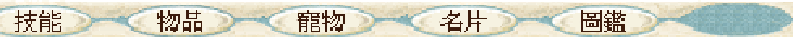
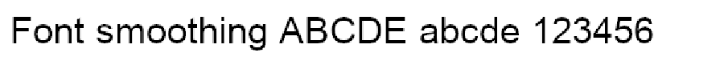

# BlueCG 放大階梯感：registry、DDRAW 與字體平滑根因實測

日期：2026-11-01（Asia/Taipei）。追蹤 [CyderBits #15](https://github.com/dspp779/CyderBits/issues/15)。

## 結論

**本次已定位的主要原因，是此版 BlueCG 在視窗放大時，自己將最後一張畫面 bitmap 設為 `COLORONCOLOR`，再以非整數、且寬高不同的倍率拉伸。** GL 與 GDI/no3d 都走到這段呼叫；單靠改 renderer 或 Windows 字體平滑，沒有改變本次底部選單的縮放結果。

同版核心的 Wine relay 實際觀測：

```text
bluecg.dll + 0xb1a18 → SetStretchBltMode(destination_dc, 3)
bluecg.dll + 0xb1aaa → StretchBlt(destination_dc, 0, 0, 1100, 791,
                               source_dc,      0, 0,  961, 721, SRCCOPY)
```

這裡的位移是 **API 呼叫者的回傳位址 RVA**，不是已辨識的函式入口；已用載入位址與核心 PE image size 核對，位址位於 `bluecg.dll` 內。`3` 是 `COLORONCOLOR`；本版 Wine 的 DIB stretch 非 HALFTONE 分支會複製／刪除行列，沒有進入色彩混合的 HALFTONE 分支。[Microsoft SetStretchBltMode 說明](https://learn.microsoft.com/en-us/windows/win32/api/wingdi/nf-wingdi-setstretchbltmode)

此組寬放大 `1100/961 ≈ 1.14464×`，高放大 `791/721 ≈ 1.09709×`。一個來源像素會對應不同數量的目的像素，造成筆畫粗細不均；寬高倍率不同還會造成比例變形。這兩項影響應分開看。

## 環境、控制與範圍

| 項目 | 條件 |
|---|---|
| 主機 | Apple M4、10 核 CPU、16 GiB、macOS 27.2（26B123） |
| 顯示器 | 1680×945 points、backing scale 2、60 Hz |
| Wine | CX26.3／Wine 11，本輪 fullscreen-fix＋GDI 計時探針的隔離 runtime；沒有安裝或替換正式引擎 |
| 啟動器 | BlueLauncher 2026.10.27.01 |
| 遊戲 | 相同 EXE、核心、資源副本與角色；召喚之間靜態場景 |
| 模式 | HD[1]、`3Ddevice:1`、`GAHD`、`fontmode:system`、`fontface:MingLiU` |
| Wine 顯示設定 | RetinaMode 關閉、96 DPI；不要把它與截圖工具的 `--retina` 混為一談 |
| 字型替代 | 測試 prefix 的既有宋體替代映射固定；正控制使用 Arial，不把它視為所有中文字型的驗證 |
| renderer | 每組寫入該隔離 prefix 的 registry；**不設 WINE_D3D_CONFIG**，避免環境變數蓋過 registry |
| DDRAW | 明確指定 `ddraw=b` 或 `ddraw=n,b`，以遊戲子程序的載入日誌確認 |
| 操作 | 每組重新啟動、登入；截取原尺寸、真正 Alt+Enter 後、以及統一 1100×791 client 後的畫面；正常退出 |
| 計量範圍 | 本輪是畫質與 API 診斷。relay 有開銷，沒有把這些 run 當成 CPU、能耗或遊戲幀時間比較 |

核心 SHA-256：`832fd1de73783849251a1b397f082d289feb957eaabac1473a77ce4a28d8ed1a`。

遊戲附帶 DDRAW.dll SHA-256：`c7ba81e067690fc0d77a31c4d7a6ad4af1d0b84255275ca4974971a70394c0c7`。

完整 EXE／模組／診斷程式來源 hash 與去識別化數據見 [evidence.json](assets/scaling-2026-11-01/evidence.json)。沒有新增 BlueCG CompatDB 規則，也沒有修改其他遊戲設定。

## 你提供的四個 registry 值：哪些實際生效

另外用固定 DirectDraw 探針，在 builtin／官方 native DDRAW 下各做八種設定，共 **16 組**。每組程序重新啟動，registry 型別照原指令保留；沒有 renderer 環境變數覆寫。16 組均完成探針，結束後還原 registry。

| 設定 | 原指令的型別／值 | 本次 reader 與初始化實測 | 判讀 |
|---|---|---|---|
| `renderer` | `REG_SZ: gdi` | 出現 `Disabling 3D support.` | 有效，選擇 WineD3D no3d |
| `DirectDrawRenderer` | `REG_SZ: gdi` | 同版 Wine reader 未找到對應讀取路徑；單項不改變初始化結果 | 不作為這版有效 renderer 開關；不能將歷史 Wine 設定直接套用到目前版本 |
| `MaxVersionGL` | `REG_SZ: 1.0` | `get_config_key_dword()` 要求 `REG_DWORD`；此字串沒有產生 GL version 設定診斷 | 原指令不會因此把本次 GL 限成 1.0 |
| `CSMT` | `REG_SZ: 0` | DWORD reader 不接受；舊字串分支只接受 `disabled`，不是 `0` | 原指令未停用 multithreaded command stream |
| 四項原樣一起套用 | 上列四個字串 | 初始化診斷與只設 `renderer=gdi` 相同 | 本次有效 renderer 變更來自第一項 |
| 正控制：`CSMT` | `REG_DWORD: 0` | `Setting multithreaded command stream to 0.` | 證明日誌能辨識真正被接受的值；不是 key 大小寫問題 |
| 正控制：`MaxVersionGL` | `REG_DWORD: 0x00040001` | `Setting maximum allowed wined3d GL version to 4.1.` | 證明 DWORD 型別與版本編碼的讀取確實生效 |

正控制只是驗證 reader，**不是建議套用 CSMT=0 或限制 GL 版本**。本次沒有把有效 GL 上限改成 1.0。

本機檢查時，舊指令所指的 `~/wine-cg` 已不存在；Cyder shared bottle 的只讀檢查也沒有找到這四個 Direct3D 值。它有 `ddraw=native,builtin`、RetinaMode=n、LogPixels=96。歷史指令只會寫到所指定的 prefix，不能僅因曾執行過，就推定目前 Cyder 的所有程序仍受它影響。本輪未寫入 shared bottle。

## 七組實際遊戲比較

下表皆以相同 client **1100×791**、原生擷取 **2200×1646 PNG** 比較。每組都有獨立程序與實際 DLL 載入證據；所有組均觀測到上列同一核心 RVA 的 mode 3 拉伸。

比較的是原生截圖中「技能、物品、寵物、名片、圖鑑」與「系統」兩個固定區域；初始組的狀態面板開啟狀態不同，因此排除最左側「狀態」按鈕，沒有把 hover／選取差異混入字體比較。

| Run | renderer 實際診斷 | DDRAW 載入 | 四項原樣 | 字體平滑 | 最後 stretch mode | 底部文字差異像素* | 系統區差異像素* |
|---|---|---|---|---|---:|---:|
| GL 基準 | OpenGL | builtin | 否 | 灰階開啟 | 3 | 0 | 0 |
| GDI 單項 | no3d | builtin | 否 | 灰階開啟 | 3 | 0 | 0 |
| 原指令四項 | no3d | builtin | 是 | 灰階開啟 | 3 | 0 | 0 |
| GL＋官方 DLL | OpenGL | native＋builtin 委派 | 否 | 灰階開啟 | 3 | 0 | 0 |
| GDI＋官方 DLL | no3d | native＋builtin 委派 | 否 | 灰階開啟 | 3 | 0 | 0 |
| 關字體平滑 | OpenGL | builtin | 否 | 關閉 | 3 | 0 | 0 |
| GL 還原組 | OpenGL | builtin | 否 | 灰階開啟 | 3 | 0 | 0 |

\* 相對第一組。底部 ROI `(220,1598)-(1200,1644)` 共 **45,080 pixels**；系統 ROI `(1740,1598)-(1960,1644)` 共 **10,120 pixels**。各組兩區 RGB 平均絕對差也均為 **0**。這是指定靜態區域的結果，不是所有動畫或整張畫面相同。API 次數不是 FPS，也不是掃描輸出幀時間。

[逐組 CSV](assets/scaling-2026-11-01/comparison.csv) · [完整去識別化數據](assets/scaling-2026-11-01/evidence.json)

GL 還原組的原生底部裁圖：



GDI＋官方 DDRAW，同一尺寸的原生底部裁圖：


### 官方 DDRAW 確實有影響，但要分開判讀

- builtin 的 Alt+Enter：client **961×721 → 1100×791**。
- 官方 native DDRAW 的 Alt+Enter：client **961×721 → 1052×761**，GL／GDI 都如此。
- 為排除尺寸差異，官方 DLL 組再統一至 **1100×791**。此時底部兩個 ROI 與 builtin 完全相同，而且仍由同版 `bluecg.dll` 指定 mode 3。

所以官方 DDRAW 會影響這個放大流程的**幾何**；但本次階梯感在它沒有載入時也存在，它不是此現象的必要條件。不能把不同尺寸的截圖直接拿來判斷濾鏡優劣。

## 字體平滑是否失效：獨立正控制

使用同版 Wine、Arial、DEFAULT_QUALITY、固定字串與 640×96 DIB，關閉／灰階／ClearType 各測一組。這些是合成控制文字，不是遊戲字型或遊戲畫面。

| 設定 | SPI 回報開啟／type | 介於黑白間的 blue-channel pixels | RGB 色數 | 非灰階 pixels |
|---|---:|---:|---:|---:|
| 關閉 | 0／1 | 0 | 2 | 0 |
| 灰階 | 1／1 | 1,765 | 16 | 0 |
| ClearType | 1／2 | 2,503 | 1,856 | 3,552 |

這確認同一 Wine 可以正常產生灰階與次像素平滑，不是所有 GDI 字體都無法平滑。實際遊戲的平滑關閉組，也在**同一遊戲 prefix** 跑同一文字正控制，確認平滑真的已關閉，然後比較遊戲底部：底部仍沒有像素變化。

已經畫入 bitmap 的文字，最後再被 mode 3 拉伸時，不會因重新開啟 FontSmoothing 就自動改用平滑插值。這不代表每個字型、字號或遊戲文字區域都已逐一驗證。

## 同版 Wine 的 HALFTONE 能否工作

用同一個 640×96、16 色的灰階文字 bitmap，在同一程序的 DIB DC 重放至 **960×144（1.5×）**；唯一改變是 stretch mode。HALFTONE 組同時依 API 契約呼叫 `SetBrushOrgEx`。

| 模式 | 來源色數 | 輸出色數 | 輸出新增色數 |
|---|---:|---:|---:|
| COLORONCOLOR（3） | 16 | 16 | 0 |
| HALFTONE（4） | 16 | 246 | 230 |

**合成控制圖：COLORONCOLOR**



**合成控制圖：HALFTONE**


這證明本版 **Win32 GDI** 有可工作的平滑 bitmap stretch。歷史文件的 `WineD3D surface_cpu_blt` 不支援 `WINED3D_TEXF_LINEAR`，指的是另一條 WineD3D 軟體 blit 路徑，不能擴大成「所有 GDI 都不支援平滑」。

**本輪沒有把 HALFTONE 套到遊戲。** 上面兩張是合成控制，不是修改後遊戲截圖；尚未驗收遊戲內 HALFTONE 的效果、CPU 成本或透明／游標／更新相容性。Microsoft 亦說明 HALFTONE 需較多處理，不能直接宣稱它同時省資源。[API 說明](https://learn.microsoft.com/en-us/windows/win32/api/wingdi/nf-wingdi-setstretchbltmode)

## 重現方法與工具

1. 在獨立 prefix 保存 registry、啟動器 INI 與遊戲核心 hash。固定 HD[1]、相同場景、Retina／DPI 與 client 尺寸。
2. 排除 `WINE_D3D_CONFIG`、`CYDER_WINED3D_RENDERER` 及 AppDefaults 對 registry renderer 的覆寫。這次使用 `CYDER_COMPATDB=0` 的隔離直接啟動；未改產品規則。
3. 只在該測試 prefix 設定下列窄 relay 過濾，再完全重啟該 prefix 的測試程序：

```text
HKCU\Software\Wine\Debug
RelayInclude (REG_SZ) = gdi32.StretchBlt;gdi32.SetStretchBltMode

WINEDEBUG=-all,err+winediag,trace+loaddll,trace+relay
```

4. `renderer` 用 registry 的 `REG_SZ gl`／`REG_SZ gdi` 比較；DLL override 用本次啟動的 `ddraw=b`／`ddraw=n,b`。檢查遊戲子程序，不拿 launcher 的 GDI 呼叫當作遊戲證據。
5. 正常登入後做 Alt+Enter，另將 client 對齊 1100×791。原生擷取需明確使用 Peekaboo `see --retina --no-elements`，記錄 window ID 與實際 PNG 尺寸。
6. 用 [去識別化 relay 分析器](../../../scripts/bluecg-scaling-evidence.py) 輸出模組位移與伸縮參數。分析器拒絕模糊的多核心載入，不輸出日誌中的路徑、角色文字或其他文字：

```sh
python3 scripts/bluecg-scaling-evidence.py \
  --log /path/to/private-relay.log \
  --core-dll /path/to/test-game/bluecg.dll \
  --output /path/to/new-summary.json
```

[獨立 Win32 GDI 探針](../../../scripts/bluecg-gdi-probe.c) 不寫 registry、不注入遊戲，也不覆寫既有輸出檔。使用 llvm-mingw 等 Windows C 工具鏈編譯；這不是 Wine host build：

```sh
i686-w64-mingw32-clang -O2 -Wall -Wextra -Werror \
  -D_WIN32_WINNT=0x0a00 -DWINVER=0x0a00 -DNTDDI_VERSION=0x0A000005 \
  -municode scripts/bluecg-gdi-probe.c -o bluecg-gdi-probe.exe -lgdi32 -luser32
```

在私有測試 prefix 內執行 `font OUTPUT.bmp`，以及 `stretch INPUT.bmp WIDTH HEIGHT MODE OUTPUT.bmp`（mode 3／4）。stretch 只接受此探針產生的 top-down 32-bit BI_RGB BMP；輸出檔必須尚不存在。

驗證：四個 Python 測試通過（ASLR 位移、錯誤 caller 排除、模糊載入拒絕、私有文字不外洩）；C 以 `-Werror` 編譯，三種字體模式與兩種 stretch 通過。拒絕覆寫測試回傳 20 且原檔 hash 不變；無效 BMP 回傳 22，未建立輸出檔。

## 限制、還原與下一步

- 這是指定核心與 HD[1] 視窗放大路徑的直接證據，沒有指定哪次更新引入，也沒有證明其他客戶端版本的行為相同。
- Wine 的跨程序 WindowDC／BitBlt 讀回在初始組失敗；未用該結果分析來源像素。後續六組未再呼叫這個讀回；GL 還原組結果一致。正式畫質比較使用原生 PNG，合成控制使用同程序 DIB。
- 指定兩個靜態底部 ROI 相同，不等於整張畫面／動畫相同，也不等於實際顯示幀時間已量到。
- 更換 renderer 仍可能影響 CPU，但它與這段 bitmap 的最終採樣模式是兩個變因。本輪不提供 HALFTONE 的能耗結論。
- 所有七組已正常退出；遊戲與合成探針 prefix 的 registry 依原始備份逐檔還原，啟動器 INI 與核心 hash 已核對。沒有寫正式 shared bottle、修改其他遊戲設定或建立 CompatDB 規則。

若要改善這條路徑，下一個可驗證的實驗是：**只在 BlueCG 最後整張視窗 bitmap 的 blit，對照 HALFTONE 或 GPU 線性採樣**，並測畫質與 CPU／功率代價。維持 1:1 或等比整數倍率可減少不均勻像素複製，但不會讓點採樣本身變成平滑插值。本次沒有加入全域 GDI 濾鏡或遊戲修補。
