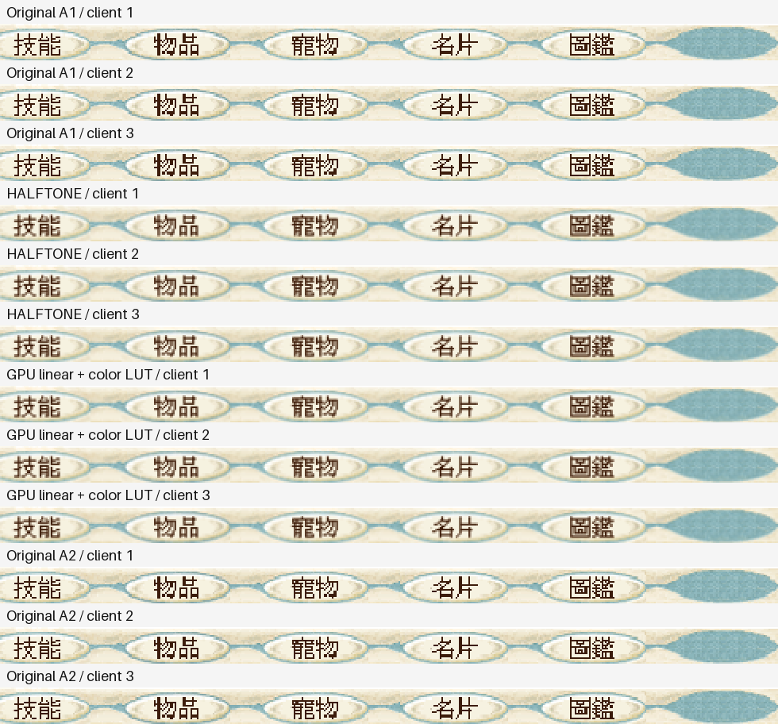

# BlueCG 三開 GPU 線性採樣、HALFTONE 與原始取樣比較

日期：2026-11-02，Asia/Taipei。追蹤 [CyderBits #15](https://github.com/dspp779/CyderBits/issues/15)。沿用 [引擎 Draft PR #8](https://github.com/dspp779/cyder-wine-engine/pull/8)、commit `5be3824` 的預設關閉原型；這輪沒有新增引擎程式碼、CompatDB 規則或正式設定。

## 本輪結論

在這台 M4、三個獨立 prefix、固定重疊放大視窗的 GDI 混合場景（窗1戶外攤販區，窗2／3室內），GPU 組三個遊戲 CPU 合計 **153.42%**、晶片 Combined **7.048 W**；HALFTONE 為 **284.53%**、**13.475 W**。本輪觀測到 GPU 相對 HALFTONE 的變化為 CPU **-46.1%**、Combined **-47.7%**。

**下列原始兩端平均僅作描述，不作嚴格等價負載基準。** 原始 A1／A2 平均 CPU **176.07%**、Combined **8.465 W**；GPU 相對原始平均變化為 CPU **-12.9%**、Combined **-16.7%**。此為整條呈現路徑成本，包含 source copy、上傳、GL context／swap 與色彩查表，不能全部歸因於單一取樣指令。

**重要限制：第一窗在法蘭城攤販區，A1與後續組的鏡頭／地景不同，戶外玩家與寵物也非固定負載。** A1→A2遊戲合計CPU漂移+7.25%、晶片功率+3.73%，CPU變化主要集中在第一窗59.52%→71.17%；不能把三開合計46.1%／47.7%的差距全部歸因於濾波，也不能將A1/A2平均當成受控節能率。三窗約60次/s只證明提交頻率相近，不代表每幀內容負載相同。

室內窗2／3的CPU合計原始A1 **110.40%**、HALFTONE **179.19%**、GPU **91.90%**、原始A2 **111.06%**；GPU對HALFTONE觀測變化 **-48.7%**。這兩窗場景與原始兩端較穩定，較直接支持降低平滑成本；仍不是三個室內窗的獨立晶片功率實驗。

每組三窗都完成實際 Alt+Enter、最小化／還原、原尺寸回退、再次放大及標準確認對話框正常退出。沒有因程序卡住而強殺遊戲；只在遊戲已退出後停止各自的隔離 server。每窗提交率及是否可比，列在下表；CPU 側 API 提交間隔不等於 GPU 完成時間、顯示 FPS 或輸入延遲。

Combined 是 **CPU＋GPU＋ANE 的晶片估計功率**，包含系統與背景工作，既不是 Wine 程序瓦數加總，也不是插座整機功率。程序 Energy Impact 是另列的指標，不能換成瓦數。

## 控制條件與採樣

| 項目 | 本輪條件 |
|---|---|
| 主機 | Apple M4、10 核、16 GiB、macOS 27.2（26B123）、接 AC、1680×945 points／2× backing／60 Hz |
| 環境 | 三個既有隔離 prefix，各自一個 wineserver；同一三個測試角色，同slot保持角色與遊戲檔案；不宣稱戶外負載固定 |
| 遊戲設定 | 窗1法蘭城攤販區；窗2／3召喚之間；HD[1]、3Ddevice:1、GAHD；renderer=gdi、ddraw=b、Wine RetinaMode 關、96 DPI；不改 soft3d 或透明度 |
| 主動切換的圖形變因 | 原始 COLORONCOLOR → CPU HALFTONE → GPU GL_LINEAR＋同一 33³ ICC LUT → 原始 A2 |
| 尺寸 | source 961×721，client 1100×791，native window 1100×823，Retina PNG 2200×1646 |
| 固定排位 | 原生座標窗1=(12,42)、窗2=(290,74)、窗3=(568,106)，全部在螢幕內；固定窗3前景，窗1、2部分遮擋 |
| 三開定義 | 三個遊戲同時更新；不是三個全可見不重疊視窗，也不是同一 prefix 共享 server |
| 每組流程 | 重新啟動與登入，逐窗生命週期檢查及截圖，暖機60秒，正式300秒，再逐窗正常退出 |
| CPU | 累積 CPU time 差分，每5秒一次，共60筆；100%＝一核心。九個程序分列 |
| 功率 | 同一完整 powermetrics 檔，5秒取樣；只取正式窗口內完整區間，排除兩端1秒與跨界區間 |
| 幀時間代理 | 各窗唯一成功完整 client SRCCOPY stream；QPC／UTC anchor對齊，同一尺寸／ROP；GPU api=3，GDI api=2 |
| 預檢排位錯誤 | 首輪預檢第三窗超出底部20px，未進正式採樣；正常關閉後調整排位重跑，該資料未列入比較 |

四組正式前景錯配均為0、thermal state峰值0、低耗電模式false。正式窗口不截圖、操作視窗或建置。A2開始後有一次約0.24秒的既有圖片離線校驗，屬背景程序負載，未送UI輸入。原始／HALFTONE要求無GPU helper log；GPU組三窗都要求Apple M4、GL_LINEAR、正確33³ LUT、errors=0及final frames記錄，不混算回退。

本輪各slot使用不同角色；窗1戶外A1重新登入後鏡頭／地景與後續組不同，H／GPU／A2的主要地景較接近但攤販動畫／玩家不能凍結。沒有另行重置角色或操作移動到同一室內場景。窗2／3室內固定位置，應分開看各slot資料。多窗遮擋與前景條件固定，並逐窗核對提交率，不能以總 CPU 降低代替負載等價檢查。單開結果另見 [單開報告](gpu-linear-2026-11-02.zh-TW.md)，本輪不把前次功率混算。

## 九個程序 CPU

| 組別 | 窗 | 遊戲平均 | 啟動器平均 | wineserver平均 |
|---|---|---|---|---|
| 原始 A1 | 1（背景） | 59.52% | 0.16% | 0.68% |
| 原始 A1 | 2（背景） | 55.28% | 0.17% | 0.65% |
| 原始 A1 | 3（前景） | 55.12% | 0.17% | 0.65% |
| HALFTONE | 1（背景） | 105.33% | 0.13% | 0.72% |
| HALFTONE | 2（背景） | 89.96% | 0.14% | 0.72% |
| HALFTONE | 3（前景） | 89.23% | 0.17% | 0.73% |
| GPU 線性＋LUT | 1（背景） | 61.52% | 0.14% | 0.70% |
| GPU 線性＋LUT | 2（背景） | 46.70% | 0.17% | 0.73% |
| GPU 線性＋LUT | 3（前景） | 45.20% | 0.17% | 0.68% |
| 原始 A2 | 1（背景） | 71.17% | 0.13% | 0.65% |
| 原始 A2 | 2（背景） | 55.84% | 0.17% | 0.69% |
| 原始 A2 | 3（前景） | 55.22% | 0.14% | 0.68% |

| 組別 | 遊戲合計 | 啟動器合計 | wineserver合計 | 九程序合計 |
|---|---|---|---|---|
| 原始 A1 | 169.91% | 0.50% | 1.98% | 172.40% |
| HALFTONE | 284.53% | 0.44% | 2.17% | 287.13% |
| GPU 線性＋LUT | 153.42% | 0.48% | 2.12% | 156.02% |
| 原始 A2 | 182.23% | 0.44% | 2.02% | 184.69% |

完整 JSON 保留各程序樣本數、取樣長度、P95 與 peak；表內總和為三程序平均相加，不代表整台主機 CPU。

## 逐窗提交間隔

| 組別 | 窗 | 提交/s | 中位ms | P95ms | P99ms | 最大ms | >50ms | >100ms | API區段中位ms | 率差≤5%對A1 |
|---|---|---|---|---|---|---|---|---|---|---|
| 原始 A1 | 1 | 59.960 | 18.271 | 23.764 | 25.657 | 75.096 | 3 | 0 | 0.429 | 是 |
| 原始 A1 | 2 | 59.971 | 17.742 | 23.675 | 25.654 | 95.878 | 3 | 0 | 0.425 | 是 |
| 原始 A1 | 3 | 59.977 | 17.977 | 23.653 | 25.509 | 73.505 | 3 | 0 | 0.427 | 是 |
| HALFTONE | 1 | 59.938 | 16.566 | 22.183 | 25.058 | 78.429 | 7 | 0 | 5.720 | 是 |
| HALFTONE | 2 | 59.983 | 17.113 | 22.793 | 24.972 | 55.915 | 1 | 0 | 5.778 | 是 |
| HALFTONE | 3 | 59.978 | 17.185 | 23.369 | 25.093 | 57.140 | 1 | 0 | 5.760 | 是 |
| GPU 線性＋LUT | 1 | 59.948 | 17.773 | 23.673 | 25.882 | 94.863 | 4 | 0 | 2.483 | 是 |
| GPU 線性＋LUT | 2 | 60.000 | 18.062 | 23.187 | 25.152 | 50.769 | 1 | 0 | 2.759 | 是 |
| GPU 線性＋LUT | 3 | 60.002 | 18.380 | 23.876 | 25.868 | 42.005 | 0 | 0 | 2.618 | 是 |
| 原始 A2 | 1 | 59.937 | 17.819 | 23.910 | 25.736 | 103.701 | 5 | 1 | 0.425 | 是 |
| 原始 A2 | 2 | 60.001 | 17.438 | 23.476 | 25.267 | 41.767 | 0 | 0 | 0.428 | 是 |
| 原始 A2 | 3 | 59.999 | 18.319 | 23.773 | 25.392 | 34.572 | 0 | 0 | 0.436 | 是 |

各窗分開計算，沒有把三個P95平均成新的P95。CPU側回傳間隔含排程／等待；GDI的後續surface flush不全在API區段內，GPU區段包含copy/upload/context/swap，故不能由區段時間直接推算CPU百分比。這個實驗沒有取得跨兩路一致的scanout時間。

## 晶片功率

| 組別 | CPU W | GPU W | ANE W | Combined W | 完整樣本 | 覆蓋秒 | counter警告樣本 |
|---|---|---|---|---|---|---|---|
| 原始 A1 | 8.087 ± 0.512 | 0.223 ± 0.010 | 0.000 ± 0.000 | 8.310 ± 0.513 | 59 | 295.83 | 11 |
| HALFTONE | 13.229 ± 0.347 | 0.246 ± 0.012 | 0.000 ± 0.000 | 13.475 ± 0.354 | 58 | 290.83 | 7 |
| GPU 線性＋LUT | 6.673 ± 0.163 | 0.376 ± 0.014 | 0.000 ± 0.000 | 7.048 ± 0.174 | 58 | 290.83 | 5 |
| 原始 A2 | 8.392 ± 0.414 | 0.227 ± 0.018 | 0.000 ± 0.000 | 8.620 ± 0.428 | 58 | 290.81 | 9 |

平均與標準差均以完整區間秒數加權；標準差反映窗口內波動，不是平均值信賴區間。完整原始輸出保留Second underflow／invalid counter警告，沒有刪除警告後宣稱無錯誤。這是一次A→H→G→A量測，不是重複多日的統計驗證。

| 組別 | 非此runtime程序CPU合計 | 其中WindowServer CPU |
|---|---|---|
| 原始 A1 | 84.28% | 41.25% |
| HALFTONE | 65.44% | 41.47% |
| GPU 線性＋LUT | 63.12% | 32.61% |
| 原始 A2 | 72.22% | 41.22% |

原始A1的非runtime背景CPU高於HALFTONE，額外工作包括node／node_repl／git；因此與A1的晶片瓦數差不能全部歸因於取樣路徑。各組背景程序名稱與CPU保留於去識別化JSON；A2另列用以檢查漂移，沒有為了讓數字接近而刪除A1。

背景合計由powermetrics逐程序CPU計算，排除監測辨識的本輪runtime PID，包含監測器等工作。WindowServer不是Wine子程序，但也是呈現的系統成本，沒有從晶片功率中扣除。

### 逐程序 Energy Impact

| 組別 | 窗 | 遊戲 | 啟動器 | wineserver |
|---|---|---|---|---|
| 原始 A1 | 1 | 2678.60 | 2.36 | 9.87 |
| 原始 A1 | 2 | 2481.12 | 2.49 | 9.48 |
| 原始 A1 | 3 | 2434.52 | 2.51 | 9.16 |
| HALFTONE | 1 | 4843.49 | 2.08 | 9.81 |
| HALFTONE | 2 | 4132.69 | 2.20 | 9.74 |
| HALFTONE | 3 | 4126.08 | 2.39 | 9.78 |
| GPU 線性＋LUT | 1 | 2373.52 | 2.19 | 10.49 |
| GPU 線性＋LUT | 2 | 1653.83 | 2.79 | 10.81 |
| GPU 線性＋LUT | 3 | 1667.43 | 2.77 | 10.58 |
| 原始 A2 | 1 | 3138.25 | 2.18 | 8.96 |
| 原始 A2 | 2 | 2472.73 | 2.52 | 9.59 |
| 原始 A2 | 3 | 2453.93 | 2.17 | 9.50 |

此為powermetrics index，**不是W或J**，不可與Combined加總。

## 放大字體與生命週期

以下每列980×46原生像素，只裁固定底部五個按鈕，排除角色、聊天與帳號資訊。四組各三列，窗1→2→3；ICC profile均為相同Generic RGB，hash與GPU LUT目標一致。以100%原圖檢視避免網頁再次縮放。

| 窗 | HALFTONE/GPU MAE/255 | 最大通道差 | 差異像素/45080 | 原始A1/A2 MAE | A1/A2差異像素 |
|---|---|---|---|---|---|
| 1 | 0.396 | 3 | 32964 | 0.000 | 0 |
| 2 | 0.396 | 3 | 32964 | 0.000 | 0 |
| 3 | 0.396 | 3 | 32964 | 0.000 | 0 |

原始取樣仍有非整數重複行列與硬邊；HALFTONE、GPU線性以邊緣混色減輕階梯感，也同樣使bitmap較模糊，不會增加字形解析度。GPU沒有改變1100/961與791/721的不同幾何倍率。每張ROI的11,270個2×2 Retina block內部一致，沒有額外第二次平滑。

| 組別 | 窗 | Alt+Enter | 最小化還原 | 原尺寸回退 | 再次放大 | 還原/再放大字體MAE | 正常退出 |
|---|---|---|---|---|---|---|---|
| 原始 A1 | 1 | 通過 | 通過 | 通過 | 通過 | 0.000 | 通過 |
| 原始 A1 | 2 | 通過 | 通過 | 通過 | 通過 | 0.000 | 通過 |
| 原始 A1 | 3 | 通過 | 通過 | 通過 | 通過 | 0.000 | 通過 |
| HALFTONE | 1 | 通過 | 通過 | 通過 | 通過 | 0.000 | 通過 |
| HALFTONE | 2 | 通過 | 通過 | 通過 | 通過 | 0.000 | 通過 |
| HALFTONE | 3 | 通過 | 通過 | 通過 | 通過 | 0.000 | 通過 |
| GPU 線性＋LUT | 1 | 通過 | 通過 | 通過 | 通過 | 0.000 | 通過 |
| GPU 線性＋LUT | 2 | 通過 | 通過 | 通過 | 通過 | 0.000 | 通過 |
| GPU 線性＋LUT | 3 | 通過 | 通過 | 通過 | 通過 | 0.000 | 通過 |
| 原始 A2 | 1 | 通過 | 通過 | 通過 | 通過 | 0.000 | 通過 |
| 原始 A2 | 2 | 通過 | 通過 | 通過 | 通過 | 0.000 | 通過 |
| 原始 A2 | 3 | 通過 | 通過 | 通過 | 通過 | 0.000 | 通過 |

GPU三窗全生命週期合計75,366次提交、errors=0；正式窗口P95為23.19–23.88ms，沒有一致優於HALFTONE，故成本改善不等同幀節奏全面改善。

每窗三張捕獲均核對尺寸、ICC、去除標題列後的client內容與字體ROI；GPU在原尺寸要求child隱藏，重新放大要求恰有一個可見GPU child。正常退出逐窗看見標準Yes/No流程並觀察game程序結束；之後才對該隔離prefix停止server並等待。沒有測蓋上螢幕、切換顯示器、空間切換、共享prefix或長時戰鬥場景，不能外推完整遊戲相容性。

## 範圍、還原與證據

`CYDER_BLUECG_BLIT_FILTER=gpu-linear`仍預設關閉。沿用hook對bluecg.exe、自己的GUI thread、完整未轉換client、961×721 source與SRCCOPY的限制；非BlueCG隔離反控制見[單開報告](gpu-linear-2026-11-02.zh-TW.md#gpu-路徑與色彩控制)。這輪未修改其他遊戲設定或加入BlueCG CompatDB，也沒有把實驗helper安裝到正式runtime。

四組共12次遊戲正常關閉，三個隔離prefix的registry／BlueLauncher.ini逐檔精確還原，EXE／核心／官方DDRAW／launcher hash不變；本輪新增的12個helper／LUT檔核對hash後移除。測試runtime只留在私有測試目錄。powermetrics與防休眠程序均已停止；使用者先前安裝的固定參數powermetrics受限sudoers規則按原意保留，沒有新增權限。

本輪沒有引擎程式碼改動；兩架構helper與GDI32沿用單開已驗證payload，不重跑無關建置。公開檔案只含去識別化資料與選單裁圖，完整功率輸出、程序映射與全畫面保留私有。

[完整去識別化證據與原始SHA-256](assets/triple-gpu-2026-11-02/evidence.json) · [12列逐窗CSV](assets/triple-gpu-2026-11-02/comparison.csv) · [CPU工具](../../../scripts/bluecg-benchmark.py) · [提交區間分析](../../../scripts/bluecg-present-frames.py) · [功率分析](../../../scripts/bluecg-power-summary.py)。
